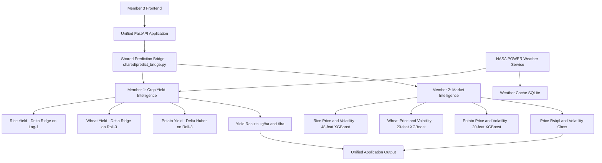

# AgroVision-ML — Multi-Crop Agricultural Intelligence Platform

> AgroVision-ML is a multi-crop agricultural intelligence platform combining biological crop yield forecasting, mandi price prediction and market volatility analysis for Rice, Wheat and Potato in West Bengal, India.

---

## Table of Contents
- [Executive Overview](#executive-overview)
- [Agricultural Problem Statement](#agricultural-problem-statement)
- [Project Objectives](#project-objectives)
- [Key Capabilities](#key-capabilities)
- [Supported Crops Overview](#supported-crops-overview)
- [System Architecture](#system-architecture)
- [Semantic Contract & Domain Data Governance](#semantic-contract--domain-data-governance)
- [Module Deep-Dives](#module-deep-dives)
  - [Member 1: Crop Yield Intelligence Engine](#member-1-crop-yield-intelligence-engine)
  - [Member 2: Agricultural Market Intelligence](#member-2-agricultural-market-intelligence)
  - [Member 3: Application & Systems Integration](#member-3-application--systems-integration)
- [Production Model Registries](#production-model-registries)
  - [Member 1 Multi-Crop Production Models](#member-1-multi-crop-production-models)
  - [Member 2 Market Intelligence Production Models](#member-2-market-intelligence-production-models)
- [Independent Validation & Performance Summary](#independent-validation--performance-summary)
- [Datasets & Agrometeorological Data Sources](#datasets--agrometeorological-data-sources)
- [Technology Stack](#technology-stack)
- [Repository Structure](#repository-structure)
- [Installation & Environment Setup](#installation--environment-setup)
- [Backend Startup & Staging Execution](#backend-startup--staging-execution)
- [API Overview & Endpoints](#api-overview--endpoints)
- [Python Prediction Bridge Usage](#python-prediction-bridge-usage)
- [Verification & Test Suite](#verification--test-suite)
- [Documentation Index](#documentation-index)
- [Known Limitations & Risk Disclosures](#known-limitations--risk-disclosures)
- [Deployment Status](#deployment-status)
- [Future Roadmap](#future-roadmap)
- [Academic Context & Team Credits](#academic-context--team-credits)

---

## Executive Overview

AgroVision-ML bridges the gap between agrometeorological science and wholesale market dynamics. By unifying biological crop yield forecasting with market arrival time-series analysis and volatility classification, the platform delivers holistic, data-driven decision support for farmers, agricultural planners, and policy stakeholders across West Bengal's major cropping agro-climatic zones.

---

## Agricultural Problem Statement

Agriculture in West Bengal faces interconnected agro-economic vulnerabilities that jeopardize smallholder livelihoods and regional food security:

1. **Food Security & Regional Sustenance**: West Bengal is India's largest rice-producing state and a major producer of potato and wheat. Ensuring stable supply chains requires precise forecasting of upcoming harvest outputs.
2. **Climate Vulnerability & Biological Yield Fluctuations**: Changing monsoon distributions, unseasonal rainfall, terminal heat stress, and relative humidity shifts introduce high inter-annual variance in crop yields. Traditional heuristic estimates fail to capture non-linear agrometeorological interactions during critical phenological growth stages.
3. **Mandi Price Shocks & Asymmetric Market Information**: Farmers face acute post-harvest price depressions and sudden price spikes caused by arrival gluts, seasonal bottlenecks, and localized speculative trading.
4. **Agro-Climatic Zone Disparities**: West Bengal spans distinct agro-climatic regions (Gangetic Alluvial, Terai-Teesta, Coastal Saline, Red & Lateritic). A macro-level generalized model fails; robust local spatial and temporal modeling is essential.

---

## Project Objectives

AgroVision-ML was engineered with three clear institutional milestones:
- **Three Core Agricultural Pillars**: Focus strictly on the primary staple and commercial crops of West Bengal: **Rice**, **Wheat**, and **Potato**.
- **Collaborative 3-Member Architecture**:
  - **Member 1**: Biological crop yield modeling with automated NASA POWER agrometeorological feature integration.
  - **Member 2**: Daily mandi price regressive forecasting, volatility regime classification, and prospective shadow monitoring.
  - **Member 3**: Application frontend, end-to-end integration, and client delivery.
- **Unified Prediction Bridge**: Seamless, decoupled integration through a hardened Python facade (`shared/predict_bridge.py`) exposing standardized semantic schemas and fail-safe persistence fallbacks.

---

## Key Capabilities

- **Multi-Crop Yield Prediction**: Production models leveraging delta-learning architectures on autoregressive baselines (Lag-1 and 3-Year Rolling Means) combined with in-season weather covariates.
- **Daily Mandi Price Forecasting**: Advanced gradient-boosted regression for next-day modal prices (Rs/quintal) trained on extensive historical Agmarknet daily auction records.
- **Multi-Horizon Price Projections**: Experimental 14-day and 30-day forecast horizons equipped with confidence bounds and automated variance inflation guards.
- **Market Volatility Classification**: Discrete regime detection (Normal vs. High/Extreme volatility) enabling early risk alerting for supply gluts and inflationary spikes.
- **Autonomous NASA POWER Weather Pipeline**: Automated coordinate-to-district mapping, daily weather ingestion, feature aggregation across phenological phases, and local SQLite caching.
- **Prospective Shadow Evaluation**: Continuous background staging framework capturing live Agmarknet mandi feeds, tracking forecast errors over time, and auditing data drift.

---

## Supported Crops Overview

AgroVision-ML strictly supports the following three agricultural crops:

| Commodity | Scientific Name | Cropping Seasons Modeled | Primary Growing Regions (West Bengal) | Production Status |
| :--- | :--- | :--- | :--- | :--- |
| **Rice** | *Oryza sativa* | Autumn (*Aus*), Winter (*Aman*), Summer (*Boro*) | Burdwan, Hooghly, Murshidabad, Midnapore, Nadia | **PRODUCTION READY** |
| **Wheat** | *Triticum aestivum* | Rabi | Malda, Murshidabad, Nadia, Birbhum, Dinajpur | **PRODUCTION READY** |
| **Potato** | *Solanum tuberosum* | Rabi | Hooghly, Burdwan, Bankura, Paschim Medinipur | **PRODUCTION READY** |

---

## System Architecture

The following diagram illustrates the end-to-end system topology, component interactions, and data flows between user interfaces, the shared bridge, and the respective specialized machine learning engines:



---

## Semantic Contract & Domain Data Governance

AgroVision enforces strict data domain boundaries to prevent conflation between biological productivity and commercial commodity transactions:

```
┌────────────────────────────────────────────────────────────────────────────────────────┐
│                                 AGROVISION METRIC TAXONOMY                             │
├────────────────────────────────┬───────────────────────────┬───────────────────────────┤
│ Concept                        │ Canonical Units           │ Producing Subsystem       │
├────────────────────────────────┼───────────────────────────┼───────────────────────────┤
│ 1. Crop Yield (Productivity)   │ kg/ha, tonnes/ha          │ Member 1 (Yield Engine)   │
│ 2. Total Production (Volume)   │ tonnes                    │ Formula: Yield × Area     │
│ 3. Mandi Arrivals (Trade Flow) │ tonnes, quintals / day    │ Member 2 (Agmarknet Feed) │
└────────────────────────────────┴───────────────────────────┴───────────────────────────┘
```

### Definitions & Usage
1. **Crop Yield ($\text{kg/ha}$ or $\text{t/ha}$)**: Represents biological harvest mass per unit of cultivated land. Generated strictly by Member 1 models.
   - *Canonical JSON keys*: `predicted_yield_kg_per_ha`, `predicted_yield_tonnes_per_ha`.
2. **Total Crop Production ($\text{tonnes}$)**: The total physical harvest aggregate volume. Computed conditionally if and only if the caller supplies cultivated area:
   $$\text{Estimated Production (tonnes)} = \text{Predicted Yield (tonnes/ha)} \times \text{Cultivated Area (ha)}$$
   - *Canonical JSON key*: `estimated_production_tonnes`.
3. **Mandi Market Arrivals ($\text{tonnes/day}$)**: Empirical commercial trade volume arriving at physical wholesale APMC markets. This is a time-series input and feature for Member 2 market forecasting. **Member 1 never predicts mandi arrivals.**
4. **Deprecated Field Notice (`yield_arrivals_tonnes`)**: In legacy prototypes, the field `yield_arrivals_tonnes` erroneously combined yield intensity with market arrival volume. This field is maintained strictly for backward compatibility in v2.x, triggers a Python `DeprecationWarning` upon access, and will be permanently removed in v3.0.

---

## Module Deep-Dives

### Member 1: Crop Yield Intelligence Engine
- **Core Technology**: Linear Ridge and Huber M-estimator Delta-Learning frameworks.
- **Architectural Formulation**: Rather than directly predicting absolute yield (which suffers from severe trend leakage and non-stationarity), models predict the historical deviation ($\Delta$) against an established baseline:
  $$\text{Predicted Yield} = \text{Baseline} + \hat{\Delta}$$
  - For **Rice**: Baseline is the district-season lag-1 yield ($\text{Yield}_{\text{lag1}}$).
  - For **Wheat & Potato**: Baseline is the 3-year rolling mean yield ($\text{Yield}_{\text{roll3}}$).
- **Agrometeorological Features**: Integrated with NASA POWER daily satellite reanalysis (T2M, T2M_MAX, T2M_MIN, PRECTOTCORR, ALLSKY_SFC_SW_DWN, RH2M) aggregated over crop growth stages (sowing, vegetative, reproductive, ripening).
- **Fail-Safe Persistence Routing**: If weather data is unavailable or input records violate physical validity thresholds, the system falls back safely to historical persistence baselines.

### Member 2: Agricultural Market Intelligence
- **Core Technology**: Extreme Gradient Boosting (XGBoost) regression and CatBoost classification.
- **Price Forecasting**: Evaluates daily market time-series, moving averages (7d, 14d, 30d), exponential volatility indicators, inter-mandi spatial spreads, and cyclical seasonal harmonics to predict modal prices ($\text{Rs/quintal}$).
- **Volatility Classification**: Models classify next-day price shifts into distinct risk tiers (Normal vs. High Volatility), identifying market anomalies driven by supply bottlenecks or festival demand spikes.
- **Multi-Horizon Modeling (Experimental)**: Direct multi-step models for 14-day and 30-day price forecasting.

### Member 3: Application & Systems Integration
- **Role**: Serves as the user-facing interface and platform integration layer.
- **Deployment Structure**: Documented and designed as an independent FastAPI service and web client that communicates directly with `shared/predict_bridge.py`.
- **Harness**: Staging validation and verification are executed through the unified staging environment and `api_v2.py`.

---

## Production Model Registries

### Member 1 Multi-Crop Production Models

All models have been serialized, cryptographically hashed, and verified against independent historical out-of-time holdouts:

| Crop | Artifact File | Algorithm Architecture | Features | Season Scope | SHA-256 Checksum | Operational Status |
| :--- | :--- | :--- | :---: | :---: | :--- | :---: |
| **Rice** | `m1_improved_delta_ridge.pkl` | Delta Ridge on Lag-1 | 20 | Autumn, Winter, Summer | `3099c2d6d113105f185111f6b1f02004229cc0e32318e9f35532841f7d4dcb56` | **PRODUCTION READY** |
| **Wheat** | `m1_wheat_delta_ridge.pkl` | Delta Ridge on 3-Yr Rolling Mean | 18 | Rabi | `a24ee4a3e90f58186272c5e79ae55cee78a350df1af57e8024145c18607a55c0` | **PRODUCTION READY** |
| **Potato** | `m1_potato_delta_huber.pkl` | Delta Huber on 3-Yr Rolling Mean | 19 | Rabi | `44102855ffeaacd88c303070c75317b08abceaa4d426e9d56636e86cf59c1e3a` | **PRODUCTION READY** |

### Member 2 Market Intelligence Production Models

| Commodity | Target Task | Primary Model Artifact | Algorithm | Feature Count | Horizon |
| :--- | :--- | :--- | :--- | :---: | :---: |
| **Rice** | Modal Price ($\text{Rs/qtl}$) | `rice_price_model.pkl` | 48-feature XGBoost Regressor | 48 | 1-Day (Production) |
| **Rice** | Volatility Regime | `rice_volatility_normalized_model.pkl` | Normalized XGBoost Classifier | 48 | 1-Day (Production) |
| **Rice** | Multi-Horizon Price | `rice_price_model_14d.pkl` / `30d.pkl` | Multi-Step XGBoost Regressor | 48 | 14D & 30D (**Experimental**) |
| **Wheat** | Modal Price ($\text{Rs/qtl}$) | `wheat_price_model.pkl` | 20-feature XGBoost Regressor | 20 | 1-Day (Production) |
| **Wheat** | Volatility Regime | `wheat_volatility_model.pkl` | Balanced XGBoost Classifier | 20 | 1-Day (Production) |
| **Potato** | Modal Price ($\text{Rs/qtl}$) | `potato_price_model.pkl` | 20-feature XGBoost Regressor | 20 | 1-Day (Production) |
| **Potato** | Volatility Regime | `potato_volatility_model.pkl` | CatBoost Balanced Classifier | 20 | 1-Day (Production) |

---

## Independent Validation & Performance Summary

> [!NOTE]
> All reported model performance metrics are evaluated on **independent historical out-of-time holdouts** (testing unseen future crop years relative to training splits). They are strictly historical out-of-sample evaluations, not live prospective harvest trials. $R^2$ represents the coefficient of determination; it is never claimed as a percentage "accuracy".

| Commodity | Evaluation Window | Evaluation Type | Sample Size ($N$) | Production Model MAE | Naive Persistence MAE | 95% Bootstrap Confidence Interval Improvement | Production Gate Decision |
| :--- | :---: | :--- | :---: | :---: | :---: | :---: | :---: |
| **Rice** | 2020–2022 | Out-of-Time Holdout | 192 | **$261.84\text{ kg/ha}$** | $284.17\text{ kg/ha}$ | $+22.33\text{ kg/ha}$ improvement over lag-1 | **PRODUCTION READY** |
| **Wheat** | 2015–2022 | 8-Yr Multi-Split Out-of-Time | 159 | **$428.46\text{ kg/ha}$** | $496.80\text{ kg/ha}$ | $[+31.84, +107.90]\text{ kg/ha}$ | **PRODUCTION READY** |
| **Potato** | 2015–2022 | 8-Yr Multi-Split Out-of-Time | 168 | **$4,560.00\text{ kg/ha}$** | $5,648.12\text{ kg/ha}$ | $[+471.11, +1,720.92]\text{ kg/ha}$ | **PRODUCTION READY** |

---

## Datasets & Agrometeorological Data Sources

1. **Directorate of Economics and Statistics (DES APY)**:
   - Official historical district-level crop statistics across West Bengal (1998–2022).
   - Provides ground-truth harvested area ($\text{ha}$), total production ($\text{tonnes}$), and yield ($\text{kg/ha}$).
2. **Agmarknet (Ministry of Agriculture & Farmers Welfare / data.gov.in)**:
   - Daily arrival volumes and modal wholesale transaction prices across regulated APMC mandis in West Bengal.
   - Cleaned, audited for calendar consistency, and normalized for weekend/holiday trade gaps.
3. **NASA POWER Agrometeorology API**:
   - Surface meteorological and solar energy dataset derived from NASA satellite observations and assimilation models.
   - Spatial resolution: $0.5^\circ \times 0.625^\circ$; integrated through automated coordinate queries and cached locally via SQLite (`member1-yield-model/data/weather_cache.sqlite`).

---

## Technology Stack

| Layer | Technologies & Libraries | Version Constraints | Purpose |
| :--- | :--- | :--- | :--- |
| **Language Runtime** | Python | `>=3.10, <=3.13` | Platform runtime environment |
| **Core Numerical & Tabular** | NumPy, Pandas, SciPy | NumPy $\ge 1.24$, Pandas $\ge 2.0$ | Feature manipulation and time-series math |
| **Machine Learning Core** | scikit-learn | $\ge 1.3.0$ | Ridge regression, Huber M-estimators, cross-validation |
| **Gradient Boosting** | XGBoost, CatBoost | XGBoost $\ge 2.0$, CatBoost $\ge 1.2$ | Mandi price forecasting & volatility classification |
| **Model Persistence** | Joblib | $\ge 1.3.0$ | Serialized artifact storage and loading |
| **Application & API** | FastAPI, Uvicorn, Pydantic | FastAPI $\ge 0.100$, Uvicorn $\ge 0.22$ | Asynchronous REST service & validation schemas |
| **Data Storage & Caching** | SQLite3 | Native | Weather caching & prospective shadow event logs |
| **Testing & Quality Assurance** | Pytest, Pytest-Cov | Pytest $\ge 7.0$ | Integration, regression, and unit test suites |

---

## Repository Structure

```
AgroVision-ML/
├── .agents/                                # Agent execution environments & skills
├── deliverables/                           # Packaged deployable modules
│   └── member2-ml/                         # Member 2 standalone inference package
├── member1-yield-model/                    # Biological crop yield engine (Member 1)
│   ├── data/                               # APY historical datasets & weather cache
│   ├── models/                             # Production yield models & metadata
│   ├── reports/                            # Member 1 audit, validation & research reports
│   ├── scripts/                            # Data processing & offline model training
│   ├── src/                                # Core modeling, weather client & inference
│   └── tests/                              # Member 1 test suite (151 passing tests)
├── member2-price-volatility/               # Market intelligence engine (Member 2)
│   ├── artifacts/                          # Serialized price & volatility models
│   ├── commodities/                        # Commodity-specific documentation
│   │   ├── rice/                           # Rice pipeline documentation
│   │   ├── wheat/                          # Wheat pipeline documentation
│   │   └── potato/                         # Potato pipeline documentation
│   ├── data/                               # Daily Agmarknet records & shadow DBs
│   ├── src/                                # Feature engineering, telemetry & API v2
│   └── tests/                              # Member 2 test suite (282 passing tests)
├── reports/                                # Cross-platform reports & audits
│   ├── deployment/                         # Operational readiness audits
│   └── member1/                            # Detailed agronomic research reports
├── shared/                                 # Centralized prediction bridge
│   ├── paths.py                            # Deterministic path resolver
│   └── predict_bridge.py                   # AgroVisionPredictor unified facade
├── staging/                                # Staging server scripts & configuration
│   ├── .env.staging                        # Staging environment configuration
│   ├── start_staging.ps1                   # Windows PowerShell startup script
│   └── start_staging.sh                    # Linux/macOS Bash startup script
├── tests/                                  # Root end-to-end integration tests (23 passing)
├── requirements.txt                        # Unified project dependencies
└── README.md                               # Platform documentation
```

---

## Installation & Environment Setup

### 1. Prerequisites
Ensure Python 3.10+ (64-bit) and `pip` are installed:
```bash
python --version
```

### 2. Clone Repository & Setup Virtual Environment
```bash
git clone https://github.com/your-org/AgroVision-ML.git
cd AgroVision-ML

# Create and activate virtual environment
python -m venv venv

# Windows (PowerShell):
.\venv\Scripts\Activate.ps1

# Linux / macOS:
source venv/bin/activate
```

### 3. Install Dependencies
```bash
pip install --upgrade pip
pip install -r requirements.txt
```

### 4. Configure Environment Variables
Set `PYTHONPATH` to include both the root repository and the Member 2 source directory:

**Windows PowerShell:**
```powershell
$env:PYTHONPATH = ".;./member2-price-volatility/src"
$env:AGROVISION_ENV = "staging"
```

**Linux / macOS:**
```bash
export PYTHONPATH=".:./member2-price-volatility/src"
export AGROVISION_ENV="staging"
```

---

## Backend Startup & Staging Execution

To launch the unified staging backend server, execute the launch script from the `staging/` directory:

### Windows PowerShell
```powershell
cd staging
.\start_staging.ps1
```

### Linux / macOS
```bash
cd staging
chmod +x start_staging.sh
./start_staging.sh
```

### Direct Uvicorn Launch
Alternatively, launch directly via Uvicorn from the project root:
```bash
python -m uvicorn api_v2:app --app-dir member2-price-volatility/src --host 0.0.0.0 --port 8000 --reload
```
Once started, the interactive OpenAPI documentation is available at `http://localhost:8000/docs`.

---

## API Overview & Endpoints

The platform provides unified staging endpoints supporting both multi-crop and legacy routes:

### 1. System Health & Telemetry
- `GET /health` / `GET /v2/health`: Verifies operational readiness of Member 1 and Member 2 model artifacts.
- `GET /v2/health/{commodity}`: Returns commodity-specific pipeline status (`rice`, `wheat`, `potato`).
- `GET /v2/metrics`: Exposes latency percentiles (P50, P95), request counts, and error rates.

### 2. Multi-Crop Prediction
- `POST /v2/predict`: Unified prediction endpoint handling both yield prediction and market forecasting.
- `POST /predict`: Backward-compatible prediction endpoint.

#### Example Request: Rice Yield Prediction
```json
POST /v2/predict
{
  "commodity": "rice",
  "prediction_type": "yield",
  "district": "Hooghly",
  "season": "Winter",
  "yield_lag1": 2850.0,
  "crop_year": 2023
}
```

#### Example Response:
```json
{
  "status": "success",
  "commodity": "rice",
  "prediction_type": "yield",
  "predicted_yield_kg_per_ha": 2912.45,
  "predicted_yield_tonnes_per_ha": 2.912,
  "model_used": "m1_improved_delta_ridge.pkl",
  "model_type": "delta_ridge_lag1"
}
```

### 3. Multi-Horizon Forecasting (Experimental)
- `POST /predict-horizon`: Direct multi-step price forecasts across 14-day and 30-day timeframes.
- `GET /health/horizons`: Health status of multi-horizon regressors.

---

## Python Prediction Bridge Usage

The `AgroVisionPredictor` facade (`shared/predict_bridge.py`) is the single programmatic entry point for Member 3 and external consumers:

```python
from shared.predict_bridge import AgroVisionPredictor

# Initialize the predictor facade
predictor = AgroVisionPredictor()

# 1. Rice Yield Prediction
yield_res = predictor.predict_yield({
    "District": "Hooghly",
    "Season": "Winter",
    "Yield_lag1": 2850.0
})
print(f"Rice Predicted Yield: {yield_res['predicted_yield_kg_per_ha']:.2f} kg/ha")
print(f"Rice Predicted Yield: {yield_res['predicted_yield_tonnes_per_ha']:.3f} t/ha")

# 2. Wheat Price Prediction
wheat_history = [
    {"date": "2024-03-01", "modal_price": 2250.0, "arrivals": 45.0},
    {"date": "2024-03-02", "modal_price": 2270.0, "arrivals": 50.0},
    # ... requires recent daily history series
]
wheat_res = predictor.predict_price(wheat_history, commodity="wheat")
print(f"Wheat Predicted Price: Rs {wheat_res['predicted_price_rs_per_qtl']:.2f}/qtl")
print(f"Market Volatility: {wheat_res['volatility_class']}")

# 3. Potato Price Prediction
potato_history = [
    {"date": "2024-02-10", "modal_price": 1050.0, "arrivals": 120.0},
    {"date": "2024-02-11", "modal_price": 1080.0, "arrivals": 115.0},
]
potato_res = predictor.predict_price(potato_history, commodity="potato")
print(f"Potato Predicted Price: Rs {potato_res['predicted_price_rs_per_qtl']:.2f}/qtl")
print(f"Market Volatility: {potato_res['volatility_class']}")
```

---

## Verification & Test Suite

The AgroVision platform enforces automated test coverage across unit, regression, end-to-end integration, and backward-compatibility suites:

```bash
# 1. Execute Root Integration & Contract Tests
pytest tests/ -v

# 2. Execute Member 1 Crop Yield Tests
pytest member1-yield-model/tests/ -v

# 3. Execute Member 2 Market Intelligence Tests
pytest member2-price-volatility/tests/ -v
```

### Comprehensive Test Summary
```
================================== TEST RESULTS ==================================
  Directory / Suite                     Tests Passed    Pass Rate    Status
----------------------------------------------------------------------------------
  tests/ (Root E2E & Bridge Contracts)      23 / 23       100%       PASSED
  member1-yield-model/tests/               151 / 151      100%       PASSED
  member2-price-volatility/tests/          282 / 282      100%       PASSED
----------------------------------------------------------------------------------
  TOTAL PLATFORM TEST SUITE                456 / 456      100%       ALL PASSED
==================================================================================
```

---

## Documentation Index

Detailed architectural documentation, research whitepapers, and operational runbooks are accessible via relative paths:

- **Member 1 (Crop Yield)**:
  - [Member 1 Overview & Architecture](member1-yield-model/README.md)
  - [Member 1 Production & Audit Reports Index](reports/member1/)
  - [Multi-Crop Final Readiness Audit](reports/member1/M7_Multi_Crop_Production_Readiness.md)
  - [Wheat Yield Independent Validation Report](reports/member1/M7_Wheat_Independent_Validation.md)
  - [Potato Yield Independent Validation Report](reports/member1/M7_Potato_Independent_Validation.md)
  - [NASA POWER Live Weather Integration Report](reports/member1/M1_Live_Weather_Service_Report.md)
- **Member 2 (Market Intelligence)**:
  - [Member 2 Overview & Market Pipelines](member2-price-volatility/README.md)
  - [Rice Commodity Market Runbook](member2-price-volatility/commodities/rice/README.md)
  - [Wheat Commodity Market Runbook](member2-price-volatility/commodities/wheat/README.md)
  - [Potato Commodity Market Runbook](member2-price-volatility/commodities/potato/README.md)
  - [Member 2 Standalone Deliverable Package](deliverables/member2-ml/)

---

## Known Limitations & Risk Disclosures

1. **Independent Historical Holdouts vs. Live Prospective Trials**:
   Current validation metrics are derived from out-of-time historical holdout datasets (2020–2022 for Rice; 2015–2022 multi-split for Wheat and Potato). While leakage-free and structurally independent, they do not constitute live prospective in-field trials.
2. **Provisional Summer (*Boro*) Rice Routing**:
   Summer (*Boro*) rice exhibits high irrigation dependence and acute climate sensitivity. Under extreme unseasonal weather deviations, the model defaults to conservative persistence routing.
3. **Experimental Multi-Week Price Horizons (14-Day & 30-Day)**:
   Longer forecast horizons are classified as **EXPERIMENTAL**. Autoregressive compounding and exogenous market shocks (e.g., export bans, sudden fuel price shifts) increase variance over extended horizons.
4. **Prospective Shadow Monitoring in Staging**:
   The automated daily Agmarknet ingestion pipeline and shadow evaluation framework are actively accumulating out-of-sample live observations in staging to monitor concept and covariate drift.

---

## Deployment Status

**Status: STAGING READY — FINAL OPERATIONAL GAPS**

The platform has achieved 100% test passage across all 456 verification cases and completed all cross-member interface contracts. Before full enterprise production deployment, the following operational steps remain:
- Finalizing production HTTPS/TLS termination and reverse proxy hardening.
- Integrating external Prometheus / Grafana scraping endpoints for the telemetry engine.
- Completing a full prospective harvest cycle validation across all three commodities.

---

## Future Roadmap

- **Prospective Harvest Field Validation**: Conduct live parallel tracking with agricultural extension centers during the upcoming Kharif and Rabi harvest cycles.
- **Automated Satellite Soil Moisture Ingestion**: Integrate Sentinel-1/2 SAR backscatter and SMAP surface soil moisture indices into Member 1's feature pipelines.
- **Enterprise Infrastructure & Cloud Deployment**: Package services into multi-container Docker topologies orchestrated via Kubernetes with automated Horizontal Pod Autoscaling (HPA).
- **Expanded Mandi Spatial Spreads**: Expand Member 2 spatial arbitrage graph networks to monitor price transmission dynamics across inter-state border mandis.

---

## Academic Context & Team Credits

This platform was developed as an **MCA Semester 3 Capstone Engineering Project** by a collaborative 3-member team:

- **Member 1**: Crop Yield ML, Biological Modeling & Agrometeorological Data Systems
- **Member 2**: Mandi Price Regressive Modeling, Volatility Classification & Shadow Telemetry
- **Member 3**: Frontend Application, Client Integration & Delivery Services
