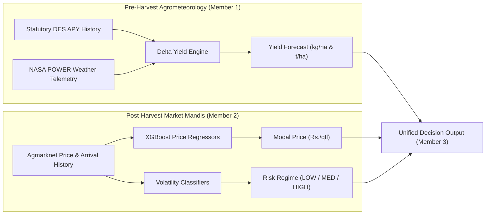

# AgroVision-ML — Multi-Crop Intelligence Directory (`commodities/`)

> **Unified agricultural intelligence documentation for the three supported crops in West Bengal, India: Rice, Wheat, and Potato.**

---

## 1. Scope & Commodity Alignment

AgroVision-ML combines **biological crop yield forecasting** (Member 1) with **wholesale mandi price prediction and volatility analysis** (Member 2). The system covers exactly three major agricultural commodities:

| Crop | Scientific Name | Agronomic Category | Production Yield Model | Mandi Price Model | Mandi Volatility Classifier | Release Status |
|:---|:---|:---|:---|:---|:---|:---:|
| [🌾 **Rice**](rice/README.md) | *Oryza sativa* | Cereals / Food Staple | Delta Ridge on Lag-1 (20 feats) | Tuned XGBoost (48 feats) + 14d/30d | Normalized XGBoost (35 feats) | **PRODUCTION READY** |
| [🌾 **Wheat**](wheat/README.md) | *Triticum aestivum* | Cereals / Rabi Food Grain | Delta Ridge on Roll-3 (18 feats) | Tuned XGBoost (20 feats) | Class-Balanced XGBoost (19 feats) | **PRODUCTION READY** |
| [🥔 **Potato**](potato/README.md) | *Solanum tuberosum* | Horticultural Cash Tuber | Delta Huber on Roll-3 (19 feats) | Tuned XGBoost (20 feats) | Class-Balanced XGBoost (19 feats) | **PRODUCTION READY** |

---

## 2. Integrated Agricultural Decision Support

For each crop, AgroVision-ML answers two critical questions across the agricultural value chain:
1. **Pre-Harvest Biological Productivity:** *What will be the harvest yield per unit area (kg/ha and tonnes/ha) given early-season weather conditions up to the cutoff date?*
2. **Post-Harvest Wholesale Market Dynamics:** *What will be the mandi modal price (Rs./quintal) and volatility risk over short-term and calendar horizons?*

---

## 3. Crop Guides Directory

- [🌾 **Rice (*Oryza sativa*) Complete Guide**](rice/README.md)
- [🌾 **Wheat (*Triticum aestivum*) Complete Guide**](wheat/README.md)
- [🥔 **Potato (*Solanum tuberosum*) Complete Guide**](potato/README.md)
