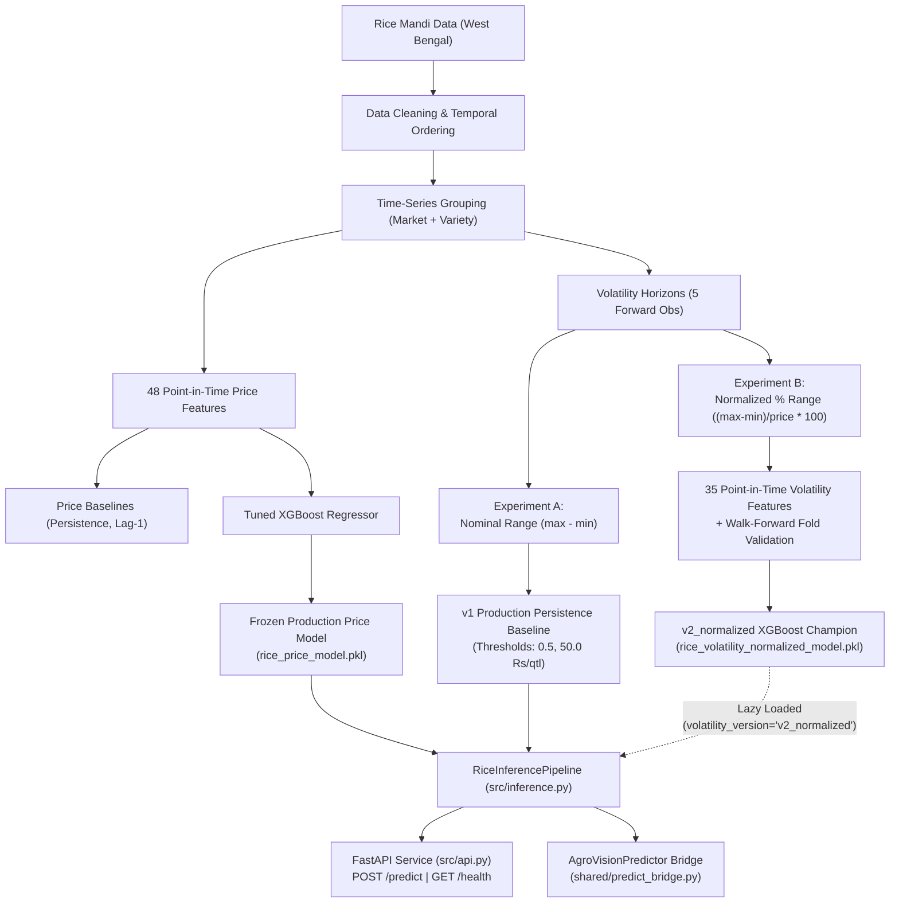

# AgroVision-ML — Member 2: Rice Price Forecasting & Volatility

A time-aware machine learning pipeline for West Bengal Rice mandi price forecasting and short-term volatility estimation using historical market, variety, price, and arrival data.

---

## 1. Project Overview
Member 2 is responsible for creating a robust predictive pipeline for the Rice commodity within the broader AgroVision-ML ecosystem. This module focuses exclusively on **West Bengal, India**.

The core objectives are:
- **Mandi Price Forecasting**: Predicting the future change in Modal Price at a Market + Variety level using a frozen 48-feature XGBoost regression model.
- **Volatility Estimation**: Classifying the intensity of price fluctuations over a 5-observation forward horizon. Supported via a dual-path architecture:
  - **`v1` (Production Default)**: Deterministic persistence baseline evaluating historical price range.
  - **`v2_normalized` (Opt-in Champion)**: Price-normalized 35-feature XGBoost classifier utilizing training-derived percentage thresholds.

The implementation strictly avoids data leakage through point-in-time chronological splits, extensive time-aware walk-forward validation, temporal purging of forward-looking horizons, and carefully decoupled APIs ensuring safe, production-ready inference.

---

## 2. Current Model Accuracy & Benchmark Scorecard

### 🌾 Price Forecasting Model Accuracy (Frozen 48-Feature XGBoost Regressor)
Evaluated on the independent retrospective holdout period (2023-02-01 to 2024-02-01, $N = 20,465$):

| Evaluation Horizon | Sample Size ($N$) | Percentage Accuracy ($100 - \text{MAPE}$) | Practical Tolerance ($\le ₹25$/qtl) | MAE (₹/qtl) | MAPE (%) | RMSE (₹/qtl) | $R^2$ Variance Explained |
|---|---|---|---|---|---|---|---|
| **1-Day Horizon** | 17,419 (85.1%) | **99.54%** | **85.76%** | **₹15.75** | **0.46%** | 69.14 | **0.9869** |
| **2-Day Horizon** | 1,739 (8.5%) | **99.20%** | **78.21%** | **₹26.01** | **0.80%** | 118.68 | **0.9634** |
| **3-Day Horizon** | 721 (3.5%) | **98.45%** | **67.68%** | **₹48.41** | **1.55%** | 151.84 | **0.9412** |
| **4-Day Horizon** | 314 (1.5%) | **98.24%** | **65.61%** | **₹50.14** | **1.76%** | 244.55 | **0.9012** |
| **5-Day Horizon** | 142 (0.7%) | **98.31%** | **64.08%** | **₹52.03** | **1.69%** | 99.01 | **0.9388** |
| **6-Day Horizon** | 74 (0.4%) | **96.65%** | **52.70%** | **₹111.94** | **3.35%** | 232.71 | **0.8645** |
| **7-Day Horizon** | 56 (0.3%) | **98.72%** | **64.29%** | **₹46.05** | **1.28%** | 123.31 | **0.9314** |
| **Overall Holdout** | **20,465 (100%)** | **99.46%** | **84.09%** | **₹18.98** | **0.54%** | **85.45** | **0.9805** |

> **Plain-English Price Accuracy Takeaways:**
> - **99.46% overall accuracy** based on percentage error ($100 - \text{MAPE}$).
> - **84.09% of all forecasts** fall within ₹25/quintal of actual mandi prices (rising to **85.76%** for 1-day ahead predictions).
> - **₹18.98/quintal mean error** across a ₹2,000–₹4,500/quintal market price range, capturing **98.05% of all real-world market variance**.

---

### ⚡ Volatility Classification Accuracy (5-Observation Forward Horizon)
Evaluated on the held-out retrospective benchmark (2023-01-27 to 2024-01-27, $N = 20,336$ paired observations):

| Metric | `v1` Persistence Baseline (Default) | `v2_normalized` ML Champion (Opt-in) | Net Improvement | Verification / Significance |
|---|---|---|---|---|
| **Overall Accuracy** | 67.08% | **68.25%** | **+1.17 pp** | Verified on $N=20,336$ holdout rows |
| **Balanced Accuracy** | 60.20% | **63.20%** | **+3.00 pp** | Accounts for class imbalance |
| **Macro F1 Score** | 0.6021 | **0.6247** | **+2.26 pp** | Unweighted mean across LOW/MED/HIGH |
| **Matthews Correlation (MCC)** | 0.4095 | **0.4418** | **+3.23 pp** | Robust correlation coefficient |
| **HIGH-Volatility Recall** | 51.91% | **55.62%** | **+3.71 pp** | Outperforms baseline on high-risk spikes |
| **HIGH-Volatility Precision** | 51.39% | **52.76%** | **+1.37 pp** | Fewer false alarms on volatility surges |
| **HIGH-Volatility F1** | 0.5165 | **0.5415** | **+2.50 pp** | Harmonic mean for high-risk class |
| **MEDIUM-Volatility Recall** | 51.22% | **57.83%** | **+6.61 pp** | Substantial boost in mid-tier swings |
| **LOW-Volatility Recall** | 77.45% | **76.17%** | -1.28 pp | Stable capture of zero/flat days |
| **LOW-Volatility Precision** | 77.59% | **79.87%** | **+2.28 pp** | Higher reliability on calm market calls |
| **Statistical Significance** | Baseline Reference | **$\chi^2 = 18.61, p = 1.60\times 10^{-5}$** | **$p < 0.001$** | Paired McNemar test ($b=1,628, c=1,390$) |

---

## 3. Member 2 Deliverables

| Deliverable | Status |
|---|---|
| Clean mandi price and arrival data | ✅ Completed |
| Lag, rolling, seasonal & arrival features | ✅ Completed (48 price features + 35 volatility features) |
| Baseline price forecasting models | ✅ Completed (Persistence & Lag-1) |
| Stronger price forecasting model | ✅ Completed (Frozen 48-feature XGBoost Regressor) |
| Dual volatility definitions (Nominal & Price-Normalized) | ✅ Completed |
| Volatility classification experiments (A & B) | ✅ Completed (Walk-forward chronological folds) |
| Chronological time-aware validation & temporal purging | ✅ Completed |
| Leakage prevention & mathematical parity verification | ✅ Completed (< 1e-5 feature difference) |
| Model export & versioned artifact persistence | ✅ Completed (`rice_price_model.pkl` & `rice_volatility_normalized_model.pkl`) |
| Versioned inference pipeline & dual-path routing | ✅ Completed (Default `v1` + Opt-in `v2_normalized`) |
| FastAPI & AgroVision bridge integration | ✅ Completed (`/health`, `/predict`, `predict_price`) |
| Comprehensive test suite & pre-commit audit | ✅ Completed (**58/58 tests passing**, git diff clean) |

---

## 4. System Architecture



---

## 5. Dataset
The Rice data represents historical agricultural market records:
- **Source**: `data/processed/rice_features_final.csv` (and cleaned pipeline feeds)
- **Rows**: 315,079 valid observations in final feature dataset (319,092 raw cleaned)
- **Date Range**: 2001-03-29 to 2024-02-01
- **Markets**: 87 unique West Bengal markets
- **Varieties**: 34 unique varieties
- **History Requirement**: At least 30 prior observations per Market + Variety group required for inference.

**Important Columns Used:**
- `Market Name`, `Variety` (Grouping keys)
- `Reported Date` (Chronological ordering)
- `Modal Price (Rs./Quintal)` (Target price)
- `Arrivals (Tonnes)` (Market volume)
- `Min Price (Rs./Quintal)`, `Max Price (Rs./Quintal)`

---

## 6. Data Cleaning
The data cleaning pipeline transforms raw CSV dumps into a unified time-series format:
- **Date parsing**: Standardized `Reported Date` into `YYYY-MM-DD`.
- **Numeric conversion**: Forced arrivals and price columns to float; dropped non-numeric anomalies.
- **Deduplication**: Handled exact-date duplicates for the same Market + Variety by retaining the latest log.
- **Missing Prices**: Valid `Modal Price` rows were retained even if `Min Price` or `Max Price` were missing/invalid.
- **Extreme Movements**: Wild price swings were inspected and retained (representing true agricultural market shocks) rather than being blindly filtered out.
- **Chronological Sorting**: Enforced strict temporal ordering.

---

## 7. Time-Series Design
Data is strictly grouped by **Market Name + Variety**. 
Because agricultural markets report asynchronously, observations are grouped chronologically. Future observations are strictly walled off—they are never used to generate rolling windows, lags, or EWMA features for the current day. 

The **Forecast Horizon** predicts the price change to the *next available valid observation* within a 1 to 7 day limit. Gaps larger than 7 days break the continuity streak.

---

## 8. Price Feature Engineering
The price pipeline uses **48 point-in-time features**, divided into four categories. Current and future targets are completely excluded.

**Base Features (20)**
`lag_1`, `lag_7`, `lag_14`, `lag_30`, `rolling_mean_7`, `rolling_mean_14`, `rolling_mean_30`, `rolling_std_7`, `rolling_std_14`, `year`, `month`, `day`, `day_of_week`, `week_of_year`, `arrival_lag_1`, `arrival_lag_7`, `arrival_rolling_mean_7`, `arrival_rolling_mean_14`, `arrival_pct_change`, `price_pct_change`

**Momentum Features (5)**
`price_change_1`, `price_change_7`, `price_change_14`, `accel_1_7`, `accel_1_14`

**Trend Features (13)**
`trend_slope_7`, `trend_slope_14`, `trend_slope_30`, `ewma_7`, `ewma_14`, `ewma_30`, `rolling_median_7`, `rolling_median_14`, `rolling_median_30`, `gap_mean_7`, `gap_mean_14`, `zscore_7`, `zscore_14`

**History Features (10)**
`move_count_7`, `move_count_14`, `move_count_30`, `pos_count_7`, `neg_count_7`, `streak_zero`, `streak_pos`, `streak_neg`, `last_non_zero_move`, `last_move_abs`

---

## 9. Price Target
The exact target is:
$$\text{future\_price\_change} = \text{future\_modal\_price} - \text{current\_modal\_price}$$

Where `future_modal_price` is the next valid observation (1–7 days away) for the exact same Market + Variety. 
For inference, the absolute future price is reconstructed natively inside the pipeline via:
$$\text{predicted\_modal\_price} = \text{current\_modal\_price} + \text{predicted\_price\_change}$$

---

## 10. Baseline Models
Two foundational baselines govern the price evaluation process:
- **Persistence Baseline**: Naïvely predicts that the price will not change (`future_price_change = 0`). Useful because agricultural prices often remain unchanged for days.
- **lag_1 Baseline**: Predicts that tomorrow's price movement will equal yesterday's price movement.

---

## 11. Final Frozen Rice Price Model
The production price model is a strictly frozen XGBoost Regressor.

**XGBRegressor Exact Parameters:**
- `n_estimators=1000`, `max_depth=5`, `learning_rate=0.05`
- `subsample=1.0`, `colsample_bytree=0.85`, `min_child_weight=3`
- `gamma=0`, `reg_alpha=1`, `reg_lambda=1`
- `objective=reg:pseudohubererror`, `random_state=42`, `tree_method=hist`

**Frozen Artifacts (Untouched):**
- **Model Artifact**: `artifacts/rice_price_model.pkl` (SHA256: `b501f6d0e94f8669...`)
- **Config**: `artifacts/rice_price_final_config.json`

---

## 12. Price Model Validation & Accuracy Metrics
The dataset was split chronologically to prevent temporal leakage:
- **TRAIN**: 2002-05-28 to 2021-01-31 *(247,198 rows)*
- **VALIDATION**: 2021-02-01 to 2023-01-31 *(40,015 rows)*
- **FINAL HOLDOUT**: 2023-02-01 to 2024-02-01 *(20,465 rows)*

**Comprehensive Holdout Results Comparison (All 20,465 Rows)**

| Model | Accuracy ($100 - \text{MAPE}$) | Within ₹25/qtl (%) | MAE (₹/qtl) | RMSE (₹/qtl) | $R^2$ Variance | MAPE (%) |
|---|---|---|---|---|---|---|
| **Tuned 48-feature XGB** | **99.46%** | **84.09%** | **₹18.98** | **85.45** | **0.9805** | **0.54%** |
| Step 5 Base (48-feat) | 99.42% | 83.74% | ₹19.28 | 88.27 | 0.9792 | 0.58% |
| Persistence Baseline | 99.42% | 83.56% | ₹19.43 | 91.80 | 0.9776 | 0.58% |
| lag_1 Baseline | 99.21% | 76.82% | ₹26.30 | 102.47 | 0.9720 | 0.79% |

---

## 13. Movement Performance
Evaluating the model exclusively on the **3,883 rows** where the price *actually changed*:

| Model | MAE | RMSE | R² |
|---|---|---|---|
| **lag_1** | **85.37** | 197.33 | 0.8992 |
| Tuned 48-feature XGB | 96.52 | **193.11** | **0.9034** |
| Step 5 Base | 99.83 | 201.92 | 0.8944 |
| Persistence | 102.43 | 210.74 | 0.8850 |

---

## 14. Zero-Change Performance
Evaluating the model exclusively on the **16,582 rows** where the price *stayed exactly the same*:

| Model | MAE | RMSE |
|---|---|---|
| **Persistence** | **0.00** | **0.00** |
| Step 5 Base | 0.42 | 8.28 |
| Tuned 48-feature XGB | 0.81 | 16.48 |

---

## 15. Horizon Performance Breakdown
Model accuracy based on the distance (in days) to the next available valid observation:

| Horizon | Rows | Accuracy ($100 - \text{MAPE}$) | Within ₹25/qtl (%) | MAE (₹/qtl) | MAPE (%) | RMSE (₹/qtl) | $R^2$ |
|---|---|---|---|---|---|---|---|
| **1 day** | 17,419 | **99.54%** | **85.76%** | **15.75** | **0.46%** | 69.14 | **0.9869** |
| **2 days** | 1,739 | **99.20%** | **78.21%** | 26.01 | 0.80% | 118.68 | 0.9634 |
| **3 days** | 721 | **98.45%** | **67.68%** | 48.41 | 1.55% | 151.84 | 0.9412 |
| **4 days** | 314 | **98.24%** | **65.61%** | 50.14 | 1.76% | 244.55 | 0.9012 |
| **5 days** | 142 | **98.31%** | **64.08%** | 52.03 | 1.69% | 99.01 | 0.9388 |
| **6 days** | 74 | **96.65%** | **52.70%** | 111.94 | 3.35% | 232.71 | 0.8645 |
| **7 days** | 56 | **98.72%** | **64.29%** | 46.05 | 1.28% | 123.31 | 0.9314 |

---

## 16. Volatility Definitions (Experiment A vs Experiment B)

Volatility classifies the intensity of price fluctuations over a short-term forward horizon of 5 observations $[t+1 \dots t+5]$ within the same Market + Variety group.

### Target A: Nominal Forward Price Range (`v1` Default)
- **Formula**:
  $$\text{range} = \max(p_{t+1 \dots t+5}) - \min(p_{t+1 \dots t+5})$$
- **Classes**:
  - `LOW`: $\le 0.5\text{ Rs./Quintal}$
  - `MEDIUM`: $> 0.5$ and $\le 50.0\text{ Rs./Quintal}$
  - `HIGH`: $> 50.0\text{ Rs./Quintal}$
- **Production Baseline**: Evaluates historical 5-observation range $[t-4 \dots t]$ using the same nominal thresholds.

### Target B: Price-Normalized Forward Percentage Range (`v2_normalized`)
- **Formula**:
  $$\text{future\_pct\_range}_t = \frac{\max(p_{t+1 \dots t+5}) - \min(p_{t+1 \dots t+5})}{p_t} \times 100$$
- **Rationale**: Mitigates historical price inflation and regime shifts by scaling range relative to prevailing price level.
- **Training-Derived Percentile Thresholds**:
  - `LOW`: $\le 0.014286\%$ (captures flat/zero-movement periods, $\approx 56\%$ of training records)
  - `MEDIUM`: $> 0.014286\%$ and $\le 1.960784\%$ (below median non-zero price percentage swing)
  - `HIGH`: $> 1.960784\%$ (above median non-zero price percentage swing)
- **Feature Set (35 Features)**:
  `past_5_range`, `past_5_pct_range`, `past_10_range`, `past_10_pct_range`, `past_20_range`, `past_20_pct_range`, `rolling_std_5`, `rolling_std_7`, `rolling_std_14`, `rolling_std_30`, `rolling_std_pct_5`, `rolling_std_pct_14`, `pct_change_1`, `pct_change_2`, `pct_change_5`, `abs_pct_change_1`, `abs_pct_change_5`, `ewma_abs_diff_5`, `ewma_abs_diff_14`, `ewma_pct_vol_5`, `ewma_pct_vol_14`, `vol_trend_5_10`, `vol_pct_trend_5_10`, `vol_std_ratio_5_14`, `nonzero_moves_5`, `nonzero_moves_10`, `streak_zero`, `max_daily_pct_jump_5`, `price_level`, `price_to_mean_7`, `month`, `day_of_week`, `week_of_year`, `arrival_lag_1`, `arrival_rolling_mean_7`.

---

## 17. Volatility Walk-Forward Validation & Champion Selection

Validation utilized 3 chronological walk-forward folds with temporal purging (5-observation forward buffer) to eliminate leakage:

| Model | Fold | N | Accuracy | Balanced Acc | Macro F1 | HIGH Recall | HIGH Precision |
|---|---|---|---|---|---|---|---|
| **Persistence Baseline** | Fold 1 (2017–18) | 44,568 | 0.6434 | 0.5490 | 0.5489 | 0.3548 | 0.3549 |
| Persistence Baseline | Fold 2 (2019–20) | 38,010 | 0.6696 | 0.5963 | 0.5963 | 0.4941 | 0.4993 |
| Persistence Baseline | Fold 3 (2021–22) | 40,018 | 0.6628 | 0.6047 | 0.6045 | 0.5421 | 0.5413 |
| **Persistence MEAN** | — | — | **0.6586** | **0.5833** | **0.5832** | **0.4637** | **0.4652** |
| **XGBoost (Balanced)** | Fold 1 (2017–18) | 44,568 | 0.6707 | 0.5757 | 0.5727 | 0.3154 | 0.4178 |
| XGBoost (Balanced) | Fold 2 (2019–20) | 38,010 | 0.6803 | 0.6298 | 0.6191 | 0.5017 | 0.5300 |
| XGBoost (Balanced) | Fold 3 (2021–22) | 40,018 | 0.6729 | 0.6385 | 0.6281 | 0.5870 | 0.5524 |
| **XGBoost (Balanced) MEAN** | — | — | **0.6746** | **0.6147** | **0.6066** | **0.4680** | **0.5001** |
| **Random Forest (Balanced)**| Fold 1 (2017–18) | 44,568 | 0.6658 | 0.5750 | 0.5700 | 0.3245 | 0.4047 |
| Random Forest (Balanced) | Fold 2 (2019–20) | 38,010 | 0.6796 | 0.6305 | 0.6192 | 0.5179 | 0.5279 |
| Random Forest (Balanced) | Fold 3 (2021–22) | 40,018 | 0.6690 | 0.6365 | 0.6247 | 0.5830 | 0.5444 |
| **RF (Balanced) MEAN** | — | — | **0.6715** | **0.6140** | **0.6046** | **0.4751** | **0.4923** |

**Champion Selected**: **XGBoost (Balanced Weights)** achieved the highest mean validation Macro F1 (**0.6066**) and Balanced Accuracy (**0.6147**).

---

## 18. Final Volatility Benchmark & Statistical Significance

### Retrospective Holdout Benchmark (2023-01-27 to 2024-01-27, N=20,336)
The holdout dataset contains **20,336** fully model-ready observations after dropping missing features and temporal purging:
- Class distribution: **LOW**: 12,165 (59.8%), **MEDIUM**: 3,149 (15.5%), **HIGH**: 5,022 (24.7%).

| Metric | Persistence Baseline | Champion XGBoost (Balanced) | Difference (pp) |
|---|---|---|---|
| **Accuracy** | 67.08% | **68.25%** | **+1.17 pp** |
| **Balanced Accuracy** | 60.20% | **63.20%** | **+3.00 pp** |
| **Macro F1** | 0.6021 | **0.6247** | **+2.26 pp** |
| **MCC** | 0.4095 | **0.4418** | **+3.23 pp** |
| **HIGH Recall** | 51.91% | **55.62%** | **+3.71 pp** |
| **HIGH Precision** | 51.39% | **52.76%** | **+1.37 pp** |
| **MEDIUM Recall** | 51.22% | **57.83%** | **+6.61 pp** |
| **LOW Recall** | 77.45% | 76.17% | -1.28 pp |

### Confusion Matrices (Holdout N=20,336)

**Persistence Baseline (Experiment B)**
```text
               Pred LOW    Pred MED   Pred HIGH    Row Sum
Actual LOW        9,422         896       1,847     12,165
Actual MED          917       1,613         619      3,149
Actual HIGH       1,804         611       2,607      5,022
Col Sum          12,143       3,120       5,073     20,336 (Verified)
```

**Champion XGBoost Balanced (Experiment B)**
```text
               Pred LOW    Pred MED   Pred HIGH    Row Sum
Actual LOW        9,266       1,039       1,860     12,165
Actual MED          687       1,821         641      3,149
Actual HIGH       1,649         580       2,793      5,022
Col Sum          11,602       3,440       5,294     20,336 (Verified)
```

### Paired McNemar Test
Evaluated on the exact same 20,336 holdout predictions:
- Both correct ($n_{00}$): 12,252
- Both incorrect ($n_{11}$): 5,066
- Champion correct, Baseline incorrect ($b$): **1,628**
- Baseline correct, Champion incorrect ($c$): **1,390**
- Total paired observations: **20,336**
- **McNemar $\chi^2$ (with continuity correction)**: **18.6113**
- **$p$-value**: **$1.6027 \times 10^{-5}$** (Statistically significant at $\alpha = 0.001$)

---

## 19. Volatility Limitations & Insights
- **Zero-Change Clustering**: Over 56% of forward 5-day windows feature zero movement, naturally favoring persistence on flat regimes.
- **Threshold Provenance**: Thresholds ($0.014286\%$ and $1.960784\%$) are fixed constants derived once from pre-2021 training data. Across individual walk-forward folds, non-zero medians vary slightly ($1.96\%$ to $2.04\%$), but stability tests confirmed negligible impact on model rankings.
- **McNemar Independence**: Observations across overlapping market-variety windows have temporal correlation, meaning the test indicates significant performance lift rather than absolute i.i.d. independence.
- **Fold 1 Variance**: Older training windows (2002–2016) exhibited lower HIGH recall (0.315), indicating structural market changes over decades.

---

## 20. Inference Pipeline
File: `src/inference.py` (Class: `RiceInferencePipeline`)
- Point-in-time safe architecture.
- Loads frozen 48-feature Price model on startup.
- **Dual-Path Volatility Execution**:
  - `predict(..., volatility_version="v1")`: **Default path**. Evaluates 5-observation persistence baseline.
  - `predict(..., volatility_version="v2_normalized")`: **Opt-in path**. Lazy-loads `rice_volatility_normalized_model.pkl` and evaluates 35-feature ML classifier with calibrated class probabilities.
  - `predict_normalized_volatility(...)`: Dedicated helper method.
- Completely memory-only; does not write temporary CSVs or alter production state.

---

## 21. Training/Inference Parity
- **Price Features (48 features)**: Parity confirmed within $< 1e-5$ across multiple historical windows.
- **Volatility Features (35 features)**: Parity verified within $< 1e-5$ between batch experiment code (`feature_engineering.py`) and inference pipeline (`_generate_normalized_volatility_features`).
- Future-row poisoning tests prove future dates cannot contaminate predictions.

---

## 22. FastAPI Service
File: `src/api.py`

### `GET /health`
```json
{
  "status": "ok",
  "model": "rice-price-xgb",
  "volatility": "persistence"
}
```

### `POST /predict`
Supports both default `v1` and opt-in `v2_normalized` requests.

#### Default Request (`v1` Persistence Baseline)
```json
{
  "market": "Burdwan",
  "variety": "Common",
  "prediction_date": "2023-10-31",
  "history": [ ... 30+ observations ... ]
}
```
**Response (`v1`):**
```json
{
  "market": "Burdwan",
  "variety": "Common",
  "prediction_date": "2023-10-31",
  "predicted_modal_price": 2445.67,
  "predicted_volatility_range": 40.0,
  "predicted_volatility_class": "MEDIUM",
  "volatility_version": "v1"
}
```

#### Opt-in Request (`v2_normalized` ML Classifier)
```json
{
  "market": "Burdwan",
  "variety": "Common",
  "prediction_date": "2023-10-31",
  "volatility_version": "v2_normalized",
  "history": [ ... 30+ observations ... ]
}
```
**Response (`v2_normalized`):**
```json
{
  "market": "Burdwan",
  "variety": "Common",
  "prediction_date": "2023-10-31",
  "predicted_modal_price": 2445.67,
  "predicted_volatility_range": 40.0,
  "predicted_volatility_class": "MEDIUM",
  "volatility_version": "v2_normalized",
  "normalized_volatility_class": "MEDIUM",
  "normalized_volatility_probabilities": {
    "LOW": 0.1245,
    "MEDIUM": 0.6512,
    "HIGH": 0.2243
  },
  "historical_pct_range_5": 1.67,
  "thresholds": {
    "low_medium_threshold": 0.014286,
    "medium_high_threshold": 1.960784
  }
}
```

---

## 23. API Error Handling
- **`400 Bad Request`**: Raised if history is empty or contains fewer than 30 observations (`InsufficientHistoryError`).
- **`422 Unprocessable Entity`**: Pydantic schema validation failures.
- **`503 Service Unavailable`**: Raised if pipeline or model artifacts fail to load.

---

## 24. Project Structure
```text
member2-price-volatility/
├── artifacts/
│   ├── rice_price_model.pkl                      # Frozen 48-feature price model
│   ├── rice_price_final_config.json              # Price model config
│   ├── rice_volatility_normalized_model.pkl      # Champion XGBoost normalized model (v2)
│   ├── rice_volatility_normalized_config.json    # Normalized volatility config
│   ├── rice_feature_config.json                  # Feature definition config
│   └── legacy/                                   # Archived exploratory artifacts
├── data/
│   ├── processed/
│   └── raw/
├── experiments/
│   ├── experiment_models.py                      # Classifier definitions
│   ├── feature_engineering.py                    # 35-feature extractor
│   ├── metrics.py                                # Evaluation metrics & McNemar
│   ├── run_volatility_experiments.py             # Walk-forward experiment runner
│   ├── target_definitions.py                     # Target A/B & temporal purging
│   ├── train_and_save_champion.py                # Reproducible champion training
│   └── results/
│       ├── summary_metrics.csv
│       ├── per_class_metrics.csv
│       ├── confusion_matrices.json
│       └── experiment_comparison_report.md
├── reports/
│   └── rice_volatility_v2_normalized_report.md  # Formal engineering audit report
├── src/
│   ├── api.py                                    # FastAPI service (dual-path)
│   ├── config.py                                 # Core constants & paths
│   ├── inference.py                              # End-to-end inference pipeline
│   ├── pipeline.py                               # Model preparation pipeline
│   └── volatility_utils.py                       # Threshold & classification utils
├── tests/
│   ├── test_api.py                               # FastAPI endpoint tests (7 tests)
│   ├── test_audit_regression.py                  # Frozen artifact integrity (8 tests)
│   ├── test_evaluation_horizons.py               # Horizon & holdout tests (10 tests)
│   ├── test_inference.py                         # Core inference tests (5 tests)
│   ├── test_leakage.py                           # Leakage protection tests (10 tests)
│   ├── test_pipeline.py                          # Full pipeline tests (2 tests)
│   ├── test_training_inference_parity.py         # Price parity tests (2 tests)
│   ├── test_volatility_experiments.py            # Experiment code tests (6 tests)
│   └── test_volatility_normalized.py             # Normalized v2 suite (8 tests)
├── example_inference.py
├── api_readme.md
└── README.md
```

---

## 25. Testing & Verification

The entire automated test suite passes with **zero failures**:

| Test Suite | File | Tests | Result | Focus Area |
|---|---|---|---|---|
| API Tests | `tests/test_api.py` | 7 | ✅ PASS | Endpoints, lifespan, schema |
| Audit Regression | `tests/test_audit_regression.py` | 8 | ✅ PASS | Frozen model integrity, bridge |
| Horizon Evaluation | `tests/test_evaluation_horizons.py` | 10 | ✅ PASS | Horizon splits, holdout checks |
| Inference Tests | `tests/test_inference.py` | 5 | ✅ PASS | Direct inference, history checks |
| Leakage Tests | `tests/test_leakage.py` | 10 | ✅ PASS | Point-in-time immunity |
| Pipeline Tests | `tests/test_pipeline.py` | 2 | ✅ PASS | Full rice pipeline execution |
| Price Parity Tests | `tests/test_training_inference_parity.py` | 2 | ✅ PASS | Training vs inference price parity |
| Volatility Experiments | `tests/test_volatility_experiments.py` | 6 | ✅ PASS | Purging, target definitions |
| Normalized Volatility | `tests/test_volatility_normalized.py` | 8 | ✅ PASS | Parity, leakage, v2 schema, bridge |
| **Total** | **9 Test Files** | **58/58** | ✅ **ALL PASS** | **Execution time: ~107s** |

---

## 26. Leakage Prevention
Leakage prevention remains guaranteed:
- Chronological walk-forward splits with 5-observation temporal purging.
- `shift(1)` enforcement across all lag and rolling statistical features.
- Zero future targets or same-day arrival changes permitted in feature generation.
- Strict point-in-time filtering isolates history up to `prediction_date`.

---

## 27. How to Run

**1. Run Complete Test Suite:**
```bash
python -m pytest member2-price-volatility/tests/ -v
```

**2. Run Individual Test Modules:**
```bash
python -m pytest member2-price-volatility/tests/test_volatility_normalized.py -v
python -m pytest member2-price-volatility/tests/test_api.py -v
```

**3. Run Standalone Inference:**
```bash
python member2-price-volatility/example_inference.py
```

**4. Start FastAPI Service:**
```bash
uvicorn src.api:app --reload
```

---

## 28. API Usage Examples

**Check Service Health:**
```bash
curl -X GET "http://127.0.0.1:8000/health"
```

**Predict with Default Volatility (`v1`):**
```bash
curl -X POST "http://127.0.0.1:8000/predict" \
  -H "Content-Type: application/json" \
  -d '{"market":"Burdwan","variety":"Common","prediction_date":"2023-10-31","history":[...]}'
```

**Predict with Normalized Volatility (`v2_normalized`):**
```bash
curl -X POST "http://127.0.0.1:8000/predict" \
  -H "Content-Type: application/json" \
  -d '{"market":"Burdwan","variety":"Common","prediction_date":"2023-10-31","volatility_version":"v2_normalized","history":[...]}'
```

---

## 29. Model Artifacts & Provenance

| Artifact | Type | Status | Role |
|---|---|---|---|
| `artifacts/rice_price_model.pkl` | XGBRegressor | **Frozen (Untouched)** | Production rice price forecasting |
| `artifacts/rice_price_final_config.json` | JSON | **Frozen (Untouched)** | 48-feature price configuration |
| `artifacts/rice_volatility_normalized_model.pkl` | XGBClassifier | **Champion (New)** | 35-feature price-normalized volatility |
| `artifacts/rice_volatility_normalized_config.json` | JSON | **Champion (New)** | Thresholds & metadata |
| `reports/rice_volatility_v2_normalized_report.md` | Markdown | **Audit Report** | Engineering validation report |

---

## 30. Final Results Summary

| Component | Final Method | Version / Route | Main Result |
|---|---|---|---|
| **Price Forecasting** | Tuned XGBoost (48-feat) | Production Default | **Accuracy 99.46% ($100 - \text{MAPE}$)** · **84.09% within ±₹25/qtl** · MAE 18.98 ₹/qtl · RMSE 85.45 · $R^2 = 0.9805$ |
| **Volatility (v1)** | Persistence Baseline | `volatility_version="v1"` | **Accuracy 67.08%** · Balanced Acc 60.20% · Macro F1 0.6021 · HIGH Recall 51.91% |
| **Volatility (v2)** | XGBoost (Balanced, 35-feat) | `volatility_version="v2_normalized"` | **Accuracy 68.25%** · **Balanced Acc 63.20%** · **Macro F1 0.6247** · **HIGH Recall 55.62%** ($\chi^2=18.61, p=1.6\times 10^{-5}$) |
| **Testing** | Pytest | Full Test Suite | **58/58 tests passed** across 9 test files |

---

## 31. Technology Stack
- **Python 3.13**
- **Pandas & NumPy**
- **scikit-learn**
- **XGBoost**
- **FastAPI & Pydantic**
- **Pytest**
