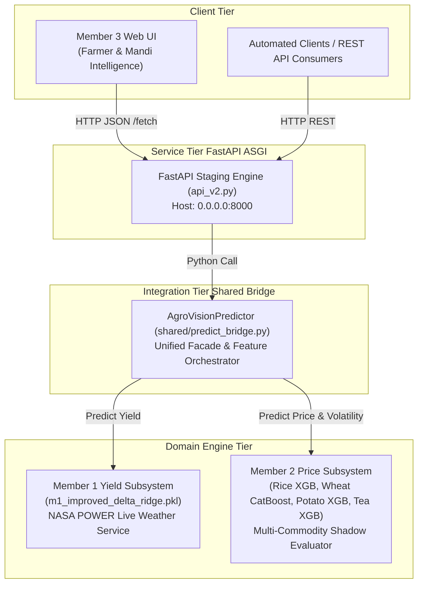

# AgroVision-ML: Member 1 + Member 2 Unified Backend & API Integration Contract

**Document Version:** 3.0.0 (Production Release Candidate)  
**Effective Date:** November 17, 2026  
**Audience:** Member 3 (FastAPI & Application Engineering Team), QA Engineers, Release Auditors  
**System Components:** Member 1 (`member1-yield-model`), Member 2 (`member2-price-volatility`), Shared Predict Bridge (`shared/predict_bridge.py`), Staging API (`api_v2.py`)  
**Document Identifier:** `M1-M2-INTEGRATION-CONTRACT-2026-11`  
**Status:** Certified Verified Contract  

---

## 1. Architectural Architecture & Integration Topology

AgroVision-ML unites two distinct agricultural machine learning domains:
1. **Member 1 (Crop Yield Intensity):** Predicts district-level agricultural productivity in **kilograms per hectare (kg/ha)** and **tonnes per hectare (tonnes/ha)** for West Bengal Rice across Autumn (*Aus*), Winter (*Aman*), and Summer (*Boro*).
2. **Member 2 (Mandi Price & Volatility):** Forecasts APMC wholesale market modal prices in **Rupees per quintal (₹/quintal)** and classifies short-to-medium term market volatility regimes (`LOW`, `MEDIUM`, `HIGH`) across Rice, Wheat, Potato, and Tea.



---

## 2. Programmatic Python Contract (`shared.predict_bridge`)

Downstream application modules must interface with the ML subsystems strictly via `shared.predict_bridge`:

```python
from shared.predict_bridge import (
    AgroVisionPredictor,
    predict,
    predict_yield,
    predict_price,
    predict_price_horizon,
    predict_all,
)
```

### 2.1 Core Method Signatures & Behavioral Contracts

#### A. Crop Yield Prediction (`predict_yield`)
```python
def predict_yield(
    data: Union[dict, list, pd.DataFrame],
    area_ha: Optional[float] = None,
    enable_seasonal_routing: Optional[bool] = None,
    weather_missing_policy: Optional[str] = None,
    auto_fetch_weather: Optional[bool] = None,
) -> Union[YieldPredictionResult, List[YieldPredictionResult], pd.DataFrame]
```
- **Supported Commodity:** **Rice ONLY**. (If non-rice records are submitted, Member 1 explicitly routes using its Rice-calibrated model).
- **Mandatory Fields:** `District`, `Season` (`Autumn`, `Winter`, `Summer`), `Yield_lag1`.
- **Dual-Unit Guarantees:** Returns both `predicted_yield_kg_per_ha` and `predicted_yield_tonnes_per_ha` ($\text{tonnes/ha} = \text{kg/ha} / 1000.0$).
- **Total Production Estimation:** `estimated_production_tonnes` is calculated **ONLY** when `area_ha > 0` is explicitly provided. If area is omitted, non-positive, or non-numeric, `estimated_production_tonnes` is strictly omitted.
- **Weather Fetching & Provenance:** When `auto_fetch_weather=True`, missing in-season weather is retrieved via `NASAWeatherService`, cut off at the seasonal boundary, and annotated with `weather_source`, `weather_latest_observation_date`, and `weather_data_freshness_hours`.

#### B. Market Price & Volatility Prediction (`predict`)
```python
def predict(
    history: Union[pd.DataFrame, List[Dict[str, Any]]],
    commodity: str = "rice",
    horizon: Union[int, str] = "short",
    market: Optional[str] = None,
    variety: Optional[str] = None,
    prediction_date: Optional[str] = None,
    return_intervals: bool = True,
    **kwargs
) -> Dict[str, Any]
```
- **Supported Commodities:** `"rice"`, `"wheat"`, `"potato"`, `"tea"`.
- **History Validation:** Requires at least **30 chronological daily observations** for time-series inputs. Fails with `ValueError` (or HTTP 400) if fewer than 30 observations are provided.
- **Horizon Values:** `"short"` (1–7 days), `14` / `"14d"`, `30` / `"30d"`.
- **Uncertainty Quantification:** Returns calibrated `volatility_probabilities` (`LOW`, `MEDIUM`, `HIGH`) summing to 1.0, plus empirical `prediction_interval` (`p10`, `p25`, `p50`, `p75`, `p90`, `symmetric_80_ci`).

#### C. Unified Multi-Domain Prediction (`predict_all`)
```python
def predict_all(
    data_df: Optional[pd.DataFrame] = None,
    commodity: Optional[str] = None,
    yield_input: Optional[dict] = None,
    area_ha: Optional[float] = None,
    **kwargs
) -> CombinedPredictionResult
```
- Returns distinctly isolated namespaces: `crop_yield` (Member 1) and `market_price` (Member 2).
- Enforces strict semantic decoupling: Mandi arrivals volume (`Arrivals_Tonnes`) is never conflated with crop yield intensity (`predicted_yield_tonnes_per_ha`).

---

## 3. Verified REST API Specifications (`api_v2.py`)

The staging server runs ASGI FastAPI on port 8000 (`start_staging.ps1` / `start_staging.sh`).

### 3.1 Universal Multi-Commodity Prediction (`POST /v2/predict`)
- **Path:** `/v2/predict`
- **Method:** `POST`
- **Request Body (`MultiCommodityPredictRequest`):**
```json
{
  "commodity": "rice",
  "market": "Burdwan",
  "variety": "Common",
  "prediction_date": "2024-05-16",
  "horizon": "short",
  "history": [
    {
      "reported_date": "2024-04-12",
      "modal_price": 2150.0,
      "arrivals": 45.0
    }
  ],
  "return_intervals": true
}
```
- **Response Body (`MultiCommodityPredictResponse`):**
```json
{
  "commodity": "rice",
  "market": "Burdwan",
  "variety": "Common",
  "prediction_date": "2024-05-16",
  "current_modal_price": 2240.0,
  "predicted_modal_price": 2248.5,
  "predicted_price_rs_quintal": 2248.5,
  "predicted_price_change": 8.5,
  "volatility": "LOW",
  "predicted_volatility_class": "LOW",
  "volatility_probabilities": {
    "LOW": 0.8200,
    "MEDIUM": 0.1500,
    "HIGH": 0.0300
  },
  "volatility_confidence": 0.8200,
  "horizon_days": 1,
  "target_date_convention": "Next valid observation within 1–7 calendar days",
  "model_name": "rice-price-xgb",
  "model_version": "1.0.0",
  "release_status": "production",
  "is_experimental": false,
  "limitations": "West Bengal rice mandi model (48 features, XGBoost Regressor).",
  "prediction_interval": {
    "p10": 2218.5,
    "p25": 2238.5,
    "p50": 2248.5,
    "p75": 2258.5,
    "p90": 2278.5,
    "symmetric_80_ci": [2218.5, 2278.5]
  }
}
```

### 3.2 Observability & Health Endpoints
- `GET /v2/health` — Aggregate status across all commodities.
- `GET /v2/health/{commodity}` — Independent health, active model version, and error rate.
- `GET /v2/metrics` — Global telemetry (P50/P95 latencies, total requests, error rates).
- `GET /v2/metrics/{commodity}` — Commodity-specific latency and drift alerts.
- `GET /v2/shadow/{commodity}/status` — Status of prospective shadow forecasts.
- `GET /v2/shadow/{commodity}/metrics` — Realized prospective metrics vs. persistence baseline.
- `POST /v2/shadow/{commodity}/evaluate` — Triggers delayed outcome matching.
- `POST /v2/ingest/{commodity}` — Real-time APMC feed ingestion endpoint.

### 3.3 Legacy Backward Compatibility Endpoints (Rice)
- `GET /health` — Legacy Rice health endpoint.
- `GET /health/horizons` — Master switch status and 14d/30d readiness.
- `POST /predict` — Legacy short-term Rice prediction (`LegacyPredictRequest` $\rightarrow$ `LegacyPredictResponse`).
- `POST /predict-horizon` — Legacy multi-horizon Rice prediction (`LegacyPredictHorizonRequest` $\rightarrow$ `LegacyPredictHorizonResponse`).

---

## 4. Commodity & Horizon Governance Matrix

| Commodity | Domain | Short Horizon (1–7d) | 14-Day Horizon | 30-Day Horizon | Yield Prediction Support |
|:---|:---:|:---:|:---:|:---:|:---:|
| **Rice** | Market Price & Risk | **Production** | **Opt-In** | **Experimental** (Advisory Warning) | **PRODUCTION CERTIFIED (Member 1)** |
| **Wheat** | Market Price & Risk | **Production** (CatBoost V2) | **Experimental** (Advisory Warning) | **Experimental** (Advisory Warning) | **EXPLICITLY UNSUPPORTED** |
| **Potato** | Market Price & Risk | **Production** (XGB V2) | **Experimental** (Advisory Warning) | **Experimental** (Advisory Warning) | **EXPLICITLY UNSUPPORTED** |
| **Tea** | Auction Price & Risk | **Production** (XGB) | Unsupported (HTTP 400) | Unsupported (HTTP 400) | **EXPLICITLY UNSUPPORTED** |

*Important Mandate:* Yield prediction is supported **exclusively for Rice** in West Bengal. Member 1 does NOT predict Wheat, Potato, or Tea yields. Any attempt to infer non-rice yields must be rejected or clearly labeled as unavailable.

---

## 5. Frontend (`ui/index.html`) Integration Specification

The frontend Farmer Application (`artifacts_backup/checkpoint_ui_integration/ui/index.html`):
1. **Dynamic Base URL Resolution:**  
   The application resolves the backend API via `getApiBaseUrl()`:
   - Priority 1: `window.__AGROVISION_API_BASE_URL__`
   - Priority 2: `localStorage.getItem('AGROVISION_API_BASE_URL')`
   - Priority 3: Browser `window.location.origin` (if hosted on non-file origin)
   - Fallback: `http://127.0.0.1:8000`
2. **Horizon Selection & Governance Badges:**  
   - Clicking `Short (1–7d)` calls `POST /predict` or `POST /v2/predict` (`horizon="short"`).
   - Clicking `14 Days` calls `POST /predict-horizon` (`horizon_days=14`).
   - Clicking `30 Days` activates the `EXPERIMENTAL` advisory badge and calls `POST /predict-horizon` (`horizon_days=30`).
3. **Stale Response Protection:**  
   Employs `AbortController` and an incremental `activeRequestId` to cancel pending in-flight requests when a user rapidly alters market, variety, or horizon selectors.
