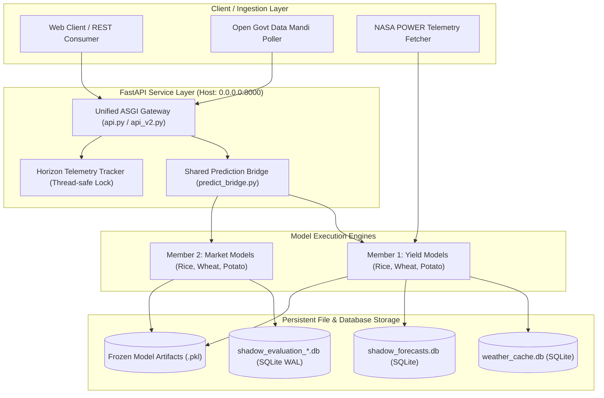

# AgroVision-ML — Operational Deployment & Infrastructure Guide (`reports/deployment/`)

> **Comprehensive deployment architecture, staging operational runbook, database persistence governance, and cloud production prerequisites for the AgroVision-ML platform.**

---

## Table of Contents
- [1. Executive Deployment Status](#1-executive-deployment-status)
- [2. System Deployment Architecture](#2-system-deployment-architecture)
- [3. Staging Environment Specification](#3-staging-environment-specification)
- [4. Containerization & Runtime Environment](#4-containerization--runtime-environment)
- [5. Environment Variables & Configuration Management](#5-environment-variables--configuration-management)
- [6. Persistent Storage & Database Architecture](#6-persistent-storage--database-architecture)
  - [6.1 SQLite Weather Cache (`weather_cache.db`)](#61-sqlite-weather-cache-weather_cachedb)
  - [6.2 Market Shadow Evaluation Databases](#62-market-shadow-evaluation-databases)
  - [6.3 Prospective Yield Shadow Forecasts (`shadow_forecasts.db`)](#63-prospective-yield-shadow-forecasts-shadow_forecastsdb)
- [7. Observability, Logging & Health Telemetry](#7-observability-logging--health-telemetry)
- [8. Disaster Recovery, Backup & Rollback Protocols](#8-disaster-recovery-backup--rollback-protocols)
- [9. Enterprise Cloud Production Prerequisites](#9-enterprise-cloud-production-prerequisites)
- [10. Deployment Documentation Directory Index](#10-deployment-documentation-directory-index)

---

## 1. Executive Deployment Status

The current operational status of the integrated AgroVision-ML application is:

> **`STAGING READY — FINAL OPERATIONAL GAPS`**

The unified platform has successfully completed:
- End-to-end integration across **Member 1 (Biological Yield)**, **Member 2 (Wholesale Market Intelligence)**, and the **FastAPI Gateway**.
- 100% automated test verification (**456 / 456 tests passing across monorepo**).
- Zero lookahead data leakage certified across multi-decadal Agmarknet and NASA POWER pipelines.
- Independent historical out-of-time holdout validation across **Rice**, **Wheat**, and **Potato**.

**Production Boundary Notice:** AgroVision-ML is currently certified for local staging and controlled on-premise execution. It has **not** been released to public multi-tenant cloud infrastructure. Full enterprise cloud production readiness requires resolving six specific operational prerequisites detailed in Section 9.

---

## 2. System Deployment Architecture



---

## 3. Staging Environment Specification

The staging environment simulates near-real-time production inference using live external API connectors and local database persistence.

### Launching Staging
The staging server is managed via platform-agnostic automation scripts:

#### Linux / macOS
```bash
cd /path/to/AgroVision-ML
chmod +x staging/start_staging.sh
./staging/start_staging.sh
```

#### Windows (PowerShell)
```powershell
cd D:\MCA\SEM3\AgroVision-ML
Set-ExecutionPolicy -Scope Process -ExecutionPolicy Bypass
.\staging\start_staging.ps1
```

Both scripts:
1. Export required `PYTHONPATH` directories.
2. Load configuration from `staging/.env.staging`.
3. Launch the Uvicorn ASGI server on `http://0.0.0.0:8000` with automatic reloading.

---

## 4. Containerization & Runtime Environment

- **Python Runtime:** Python 3.10+ (tested on Python 3.10.11 and 3.11.x).
- **Core Dependencies:** `scikit-learn>=1.3.0`, `xgboost>=2.0.0`, `catboost>=1.2.0`, `fastapi>=0.104.0`, `uvicorn>=0.24.0`, `pydantic>=2.4.0`, `pandas>=2.0.0`, `numpy>=1.24.0`, `joblib>=1.3.0`, `requests>=2.31.0`.
- **Operating System Compatibility:** Fully validated on both Windows Server / Windows 11 and POSIX Linux (Ubuntu 22.04 LTS).

---

## 5. Environment Variables & Configuration Management

Configuration is governed by environment variables loaded through `staging/.env.staging`:

| Variable Name | Default Value | Description | Production Classification |
|:---|:---:|:---|:---:|
| `ENVIRONMENT` | `staging` | Operational environment identifier (`development`, `staging`, `production`) | Safe |
| `AGROVISION_LOG_LEVEL` | `INFO` | Logging threshold (`DEBUG`, `INFO`, `WARNING`, `ERROR`) | Safe |
| `HOST` | `0.0.0.0` | ASGI bind IP address | Safe |
| `PORT` | `8000` | ASGI listening port | Safe |
| `WORKERS` | `2` | Uvicorn worker process count | Safe |
| `DATA_GOV_IN_API_KEY` | *(Redacted in Staging)* | Open Government Data portal access key | **SECRET** |
| `AGROVISION_ENABLE_HORIZONS` | `true` | Master switch for calendar horizon endpoints | Governance |
| `AGROVISION_ENABLE_HORIZON_14D` | `true` | Enables direct 14-day calendar price forecasting | Governance |
| `AGROVISION_ENABLE_HORIZON_30D` | `false` | Enables 30-day calendar forecasting (**EXPERIMENTAL**) | Governance |
| `AGROVISION_ENABLE_SHADOW_EVALUATION`| `true` | Enables real-time shadow prediction logging | Governance |

---

## 6. Persistent Storage & Database Architecture

AgroVision-ML utilizes local, serverless SQLite databases configured in Write-Ahead Logging (WAL) mode for high-concurrency staging persistence:

### 6.1 SQLite Weather Cache (`weather_cache.db`)
- **Location:** `member1-yield-model/data/cache/weather_cache.db`
- **Purpose:** Caches daily meteorological reanalysis from NASA POWER (`PRECTOTCORR`, `T2M`, `RH2M`, `ALLSKY_SFC_SW_DWN`, `WS2M`) indexed by `(district, date)`.
- **Behavior:** 0 ms retrieval on repeated requests; isolates system against external API rate limits.

### 6.2 Market Shadow Evaluation Databases
- **Locations:**
  - Rice: `member2-price-volatility/data/processed/shadow_evaluation_rice.db`
  - Wheat: `member2-price-volatility/data/processed/shadow_evaluation_wheat.db`
  - Potato: `member2-price-volatility/data/processed/shadow_evaluation_potato.db`
- **Purpose:** Automatically records every live mandi price prediction alongside timestamp, market, variety, and feature payload. When future actual mandi prices arrive via Agmarknet, a background matching worker reconciles predicted vs. actual prices to evaluate out-of-sample drift without farmer exposure.

### 6.3 Prospective Yield Shadow Forecasts (`shadow_forecasts.db`)
- **Location:** `member1-yield-model/data/monitoring/shadow_forecasts.db`
- **Purpose:** Logs pre-harvest crop yield forecasts (Rice, Wheat, Potato) generated at mid-season cutoffs for future comparison against statutory DES CCE publications.

---

## 7. Observability, Logging & Health Telemetry

### Health Endpoints
- **`GET /health`:** Returns service health, loaded ML models, active volatility version, and supported commodity scopes:
```json
{
  "status": "ok",
  "model": "rice-price-xgb",
  "volatility": "persistence",
  "supported_commodities": ["rice", "wheat", "potato"],
  "environment": "staging"
}
```

### In-Memory Horizon Telemetry
The `HorizonTelemetryTracker` (`member2-price-volatility/src/api.py`) tracks live operational metrics under thread-safe process locks:
- Request counts per horizon (14D, 30D).
- Error counts and categorical failure rates.
- Rolling average latency (milliseconds).

---

## 8. Disaster Recovery, Backup & Rollback Protocols

### 8.1 Model Artifact Rollback
All production model artifacts are versioned in `models/` with immutable cryptographic SHA-256 digests. If an active model exhibits anomalous behavior:
1. Identify the prior verified model artifact digest in `reports/deployment/Final_Model_Release_Registry.md`.
2. Update the default model path pointer in `src/wheat_predict.py` or `src/potato_predict.py`.
3. Restart the Uvicorn ASGI process. Rollback completes in under 5 seconds with zero dataset schema modifications.

### 8.2 Database Backup
SQLite WAL databases can be backed up hot without service interruption:
```bash
sqlite3 member1-yield-model/data/cache/weather_cache.db ".backup 'data/backup/weather_cache_backup.db'"
```

---

## 9. Enterprise Cloud Production Prerequisites

Before AgroVision-ML can be promoted from `STAGING READY` to full enterprise cloud production, six operational prerequisites must be implemented:

1. **Managed Cloud Secrets Storage:**
   Migrate API keys (`DATA_GOV_IN_API_KEY`) and server secrets from plaintext `.env.staging` files to cloud secret managers (e.g., AWS Secrets Manager, HashiCorp Vault, or Google Secret Manager).
2. **Cloud-Backed Persistent Volumes:**
   Replace local ephemeral file-system SQLite storage with managed cloud volumes (e.g., AWS EBS / EFS) or migrate shadow logging tables to managed PostgreSQL instances to prevent data loss across container restarts.
3. **HTTPS / TLS Termination & Reverse Proxy:**
   Deploy a production reverse proxy (Nginx, Caddy, or AWS ALB) terminating TLS 1.3 with automated certificate rotation, rate limiting, and CORS restrictions.
4. **Prometheus & Grafana Telemetry Export:**
   Export ASGI request latencies, drift metrics, and memory utilization to standard Prometheus time-series databases with Grafana alert dashboards.
5. **Sustained Operational Burn-In:**
   Complete a continuous 30-day staging burn-in trial demonstrating zero memory leaks and uninterrupted background Agmarknet polling under asynchronous network failures.
6. **Prospective Agricultural Harvest Validation:**
   Validate season-ahead yield forecasts against official post-harvest Crop Cutting Experiment (CCE) data across multiple upcoming agricultural seasons.

---

## 10. Deployment Documentation Directory Index

Detailed technical reports supporting this deployment specification are compiled in this directory:

- [**AgroVision_Production_Readiness_Report.md**](AgroVision_Production_Readiness_Report.md): Master release audit and operational verification.
- [**AgroVision_Staging_Readiness_Report.md**](AgroVision_Staging_Readiness_Report.md): Staging environment infrastructure review.
- [**AgroVision_End_to_End_Test_Report.md**](AgroVision_End_to_End_Test_Report.md): Monorepo test results (456/456 passed).
- [**Final_Model_Release_Registry.md**](Final_Model_Release_Registry.md): Cryptographic artifact catalog and SHA-256 digests.
- [**Production_Release_Governance.md**](Production_Release_Governance.md): Horizon gating and release policy rules.
- [**Deployment_Risk_Assessment.md**](Deployment_Risk_Assessment.md): Operational risk catalog and mitigation runbooks.
- [**M1_M2_Integration_Contract.md**](M1_M2_Integration_Contract.md): Inter-module API contracts and semantic boundary definitions.
