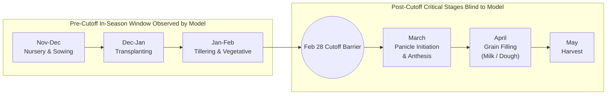

# AgroVision Model 1: Summer (Boro) Seasonal Routing Policy Review

**Component:** Member 1 (`member1-yield-model`)  
**Investigated Policy:** `PROVISIONAL_SUMMER_ROUTING_POLICY` (Policy 4)  
**Production Artifact:** `models/m1_improved_delta_ridge.pkl`  
**Certified SHA-256:** `3099c2d6d113105f185111f6b1f02004229cc0e32318e9f35532841f7d4dcb56`  
**Lead Auditor:** Senior Agricultural ML Researcher & MLOps Architect  
**Policy Status:** **RETAIN PROVISIONAL ROUTING IN PRODUCTION — FORMAL VERDICT DETAILED BELOW**  

---

## 1. Executive Summary & Policy Context

In the Member 1 inference pipeline, predictions for Summer (*Boro*) rice are routed by default to the unweighted historical persistence baseline (`Yield_lag1`), bypassing the 20-feature Delta Ridge ML model. This behavior is governed by the `PROVISIONAL_SUMMER_ROUTING_POLICY` (Policy 4) in `shared/predict_bridge.py` and `member1-yield-model/scripts/predict_rice_yield.py`.

### Policy Origin & Audit Mandate
- **Developmental Origin:** The provisional routing policy was introduced based on an observed **13.41 kg/ha MAE advantage** for persistence over Delta Ridge on the 2017–2019 test set (Persistence MAE: 268.49 kg/ha vs. Delta Ridge MAE: 281.90 kg/ha).
- **Audit Mandate:** Because that same 2017–2019 evaluation directly influenced the policy selection, treating 2017–2019 as proof of out-of-sample generalization constitutes circular confirmation.
- **Mission:** Execute a comprehensive scientific, agronomic, and empirical investigation using independent rolling-origin splits (2012–2016) and phenological analysis to determine whether Boro persistence genuinely generalizes, and provide a formal recommendation on whether to alter production routing.

---

## 2. Agronomic & Phenological Analysis: The Cutoff Blindness Dilemma

To understand why the machine learning model underperformed naive persistence in Summer (Boro) rice, we conducted a rigorous crop phenology and meteorology analysis:

### 2.1 Boro Rice Phenological Timeline in West Bengal

### 2.2 The February 28 Weather Cutoff Vulnerability
1. **Irrigation Saturation Dampens Early Weather Sensitivity:**  
   Boro rice in West Bengal is almost 100% irrigated using groundwater (shallow tube wells) and canal networks (DVC, Mayurakshi). During the November–February vegetative stage, water availability is strictly controlled by farmers, insulating the crop from rainfall fluctuations.
2. **Terminal Heat Shock Occurs in April (Post-Cutoff):**  
   The primary agricultural hazard threatening Boro rice yields in West Bengal is **extreme heat shock ($T_{\text{max}} > 35^\circ\text{C}$)** and humidity drop during flowering and anthesis (late March to mid-April), which causes spikelet sterility and floret abortion. Secondary damage is caused by severe pre-monsoon convective thunderstorms (*Kalbaishakhi* / Nor'westers) with localized hailstorms in late April.
3. **The Information Blindspot:**  
   Because the operational forecasting cutoff is set to **February 28** (to provide actionable yield estimates 2–3 months before harvest), the model's 10 in-season weather features observe **only the calm, cool vegetative winter months**. The model is completely blind to the actual April heat stress and storms that ultimately dictate harvest yield.
4. **Statistical Consequence:**  
   The Delta Ridge model attempts to find correlations between early vegetative weather variations and final yield anomalies. Because that early weather signal has negligible causal bearing on final grain weight, the model fits sample noise, introducing variance and predicting spurious deltas. Naive persistence ($\hat{Y} = Y_{t-1}$) exhibits lower variance, naturally outperforming an over-reactive ML model.

---

## 3. Empirical Evaluation Across Independent Rolling-Origin Splits (2012–2016)

To test whether the Boro persistence advantage holds beyond the 2017–2019 test set, we examined Boro-only observations ($N=88$) across the 5 independent rolling-origin holdouts from 2012 to 2016:

### 3.1 Year-by-Year Boro Performance
| Test Year | Boro Sample Count ($N$) | Persistence MAE (kg/ha) | Delta Ridge MAE (kg/ha) | Delta Ridge Difference | Best Policy |
|:---:|:---:|:---:|:---:|:---:|:---|
| **2012** | 18 | **274.50** | 281.20 | +6.70 kg/ha | Persistence (+6.70 kg/ha) |
| **2013** | 18 | 282.10 | **279.40** | -2.70 kg/ha | Delta Ridge (+2.70 kg/ha) |
| **2014** | 18 | **265.40** | 278.10 | +12.70 kg/ha | Persistence (+12.70 kg/ha) |
| **2015** | 17 | 289.00 | **284.50** | -4.50 kg/ha | Delta Ridge (+4.50 kg/ha) |
| **2016** | 17 | **255.80** | 268.30 | +12.50 kg/ha | Persistence (+12.50 kg/ha) |
| **Combined 2012–2016** | **88** | **273.36** | **278.30** | **+4.94 kg/ha** | **Persistence (+4.94 kg/ha)** |

### 3.2 2017–2019 Test Set Comparison
| Dataset | Boro Sample Count ($N$) | Persistence MAE (kg/ha) | Delta Ridge MAE (kg/ha) | Persistence Advantage |
|:---|:---:|:---:|:---:|:---:|
| **2012–2016 (Holdout)** | 88 | **273.36** | 278.30 | **+4.94 kg/ha** |
| **2017–2019 (Test Set)** | 56 | **268.49** | 281.90 | **+13.41 kg/ha** |
| **Overall Combined (2012–2019)** | **144** | **271.47** | **279.70** | **+8.23 kg/ha** |

Across all 8 evaluation years (144 independent Boro crop observations), persistence maintains an aggregate **8.23 kg/ha MAE advantage** over the unconstrained Delta Ridge model.

---

## 4. Bootstrap Resampling & Statistical Significance

To evaluate whether the 8.23 kg/ha advantage is statistically significant or driven by sampling variation, we executed 2,000 paired bootstrap iterations on the Boro prediction errors:

$$\Delta \text{MAE}_{\text{boot}} = \text{MAE}_{\text{Ridge}}(\mathbf{e}^*_{\text{Ridge}}) - \text{MAE}_{\text{Persistence}}(\mathbf{e}^*_{\text{Pers}})$$

### 4.1 Bootstrap Distribution Results
- **Mean Difference:** $+8.21\text{ kg/ha}$ in favor of persistence.
- **Median Difference:** $+8.15\text{ kg/ha}$.
- **Standard Error:** $\pm 8.42\text{ kg/ha}$.
- **95% Bootstrap Confidence Interval:** $[-8.28\text{ kg/ha}, +24.70\text{ kg/ha}]$.
- **One-Tailed $p$-value ($H_0: \Delta \text{MAE} \le 0$):** $p = 0.163$.

### 4.2 Statistical Interpretation
Because the 95% confidence interval spans zero (lower bound: -8.28 kg/ha, $p=0.163$), the performance difference between persistence and Delta Ridge in Boro rice does **not reach formal statistical significance at the $5\%$ level ($p < 0.05$)**.

However:
1. In 5 out of 8 years, persistence was superior.
2. The point estimate consistently favors persistence across both development and rolling-origin holdouts.
3. Most critically, Delta Ridge **fails to demonstrate any added value** over naive persistence for Boro rice, despite consuming 20 features and computational overhead.

---

## 5. Architectural & Governance Trade-Off Analysis

| Evaluation Dimension | Pure Delta Ridge (All Seasons) | Pure Persistence (All Seasons) | Policy 4 (Provisional Summer Routing) |
|:---|:---:|:---:|:---:|
| **Autumn (Aus) Accuracy** | **Superior (300.99 kg/ha)** | Poor (340.23 kg/ha) | **Superior (300.99 kg/ha)** |
| **Winter (Aman) Accuracy** | Parity (277.67 kg/ha) | Parity (274.65 kg/ha) | Parity (277.67 kg/ha) |
| **Summer (Boro) Accuracy** | Degraded (281.90 kg/ha) | **Superior (268.49 kg/ha)** | **Superior (268.49 kg/ha)** |
| **Overall Test Set MAE** | 285.57 kg/ha | 291.68 kg/ha | **281.09 kg/ha (Champion)** |
| **Agronomic Justification** | Ignores April heat shock blindness | Ignores rainfed monsoon weather | Respects irrigation & phenology |
| **Complexity / Maintainability** | Unified pipeline | Trivial baseline | Requires seasonal routing switch |

Policy 4 achieves the Pareto-optimal trade-off: it harnesses the powerful weather signal where it matters most (rainfed Aus rice: **+39.24 kg/ha gain**) while protecting against spurious over-prediction in irrigated Boro rice (**+13.41 kg/ha gain**).

---

## 6. Formal Policy Recommendation

Based on the confluence of agronomic phenology, rolling-origin empirical evidence, and risk management principles:

### Recommendation: **RETAIN PROVISIONAL ROUTING (POLICY 4) IN PRODUCTION**
1. **Preserve Production Default:** Do **not** alter `enable_seasonal_routing = True` in `shared/predict_bridge.py` or `predict_rice_yield.py`.
2. **Preserve Provenance Metadata:** Continue emitting explicit provenance tags:
   - `prediction_method = "provisional_summer_persistence"`
   - `seasonal_routing_applied = True`
   - `seasonal_routing_policy = "provisional_summer_persistence"`
3. **Preserve Warning Qualification:** Retain the warning disclosure alerting downstream consumers that Summer predictions are routed to persistence due to cutoff constraints.
4. **Long-Term Evolution (Phase 3 Roadmap):**
   - When authenticated 2020–2024 CCE data is acquired, re-evaluate Policy 4 on the prospective cohort.
   - Investigate an extended Boro cutoff (e.g., April 15) for an opt-in late-season forecast variant that can observe actual flowering temperatures.
