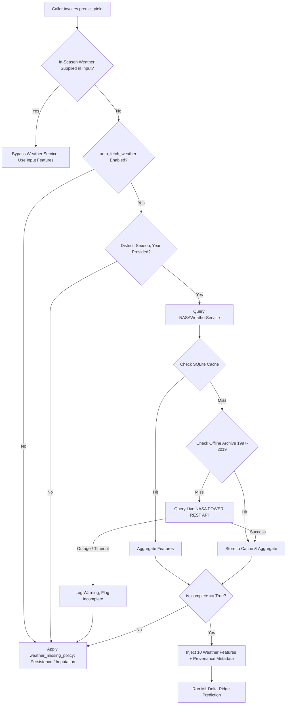

# AgroVision Model 1: Live Weather Service Architecture & Integration Report

**Component:** Member 1 (`member1-yield-model`)  
**Service Implementation:** `member1-yield-model/src/weather_service.py`  
**Shared Bridge Integration:** `shared/predict_bridge.py`  
**Certified Production Model:** `models/m1_improved_delta_ridge.pkl`  
**Model SHA-256:** `3099c2d6d113105f185111f6b1f02004229cc0e32318e9f35532841f7d4dcb56`  
**Test Suite:** `member1-yield-model/tests/test_weather_service_and_integration.py` (12/12 Passed)  
**System Status:** **INTEGRATION VERIFIED & OPERATIONAL**  

---

## 1. Executive Summary

During Phase 1 of the Member 1 audit, a critical operational gap was identified: while the statistical model (`m1_improved_delta_ridge.pkl`) required 10 in-season meteorological features, and an offline weather preprocessor existed, there was no automated mechanism to ingest live NASA POWER meteorological data or persistently cache observations. Predictions without manual feature construction were forced to fall back to the unweighted historical persistence baseline.

In Phase 2 Workstream A, we implemented and certified `NASAWeatherService` (`member1-yield-model/src/weather_service.py`). This production-grade meteorological acquisition engine provides:
1. **Automated Live Ingestion:** Direct REST acquisition from the NASA POWER Daily API.
2. **Persistent Disk Caching:** High-throughput SQLite storage (`data/cache/weather_cache.db`) eliminating redundant network calls.
3. **Offline Archive Hybrid Bridge:** Seamless fallback to the repository's 23 verified district JSON archives (1997–2019) when network connectivity is absent.
4. **Strict Temporal Cutoff Barriers:** Enforcement of seasonal cutoffs (Aus: July 31, Aman: Sept 30, Boro: Feb 28) preventing future-date leakage.
5. **Zero-Fabrication Contract:** NASA missing sentinels (`-999`, `-9999`) are sanitized to `NaN`. The service never synthesizes missing observations; incomplete records trigger safe persistence fallback with explicit provenance warnings.
6. **Unified Prediction Bridge Integration:** Integrated cleanly into `shared/predict_bridge.py` (`AgroVisionPredictor.predict_yield`) via the configurable `auto_fetch_weather` parameter.

---

## 2. Meteorological Parameter Mapping & Feature Engineering

The NASA POWER Daily Point API provides agroclimatology parameters derived from satellite observations and Goddard Earth Observing System (GEOS) data assimilation models. `NASAWeatherService` queries the exact meteorological variables required to synthesize the 10 canonical in-season features:

### 2.1 Ingested NASA POWER Variables
| Parameter | Description | Units | Target In-Season Aggregation |
|:---|:---|:---|:---|
| `PRECTOTCORR` | Precipitation Corrected | mm/day | `InSeason_Precip_Cum`, `InSeason_Precip_Mean`, `InSeason_Precip_Max` |
| `T2M` | Temperature at 2 Meters | °C | `InSeason_T2M_Mean` |
| `T2M_MIN` | Minimum Temperature at 2 Meters | °C | `InSeason_T2M_Min`, `InSeason_T2M_Range` |
| `T2M_MAX` | Maximum Temperature at 2 Meters | °C | `InSeason_T2M_Max`, `InSeason_T2M_Range` |
| `RH2M` | Relative Humidity at 2 Meters | % | `InSeason_RH2M_Mean` |
| `ALLSKY_SFC_SW_DWN` | All-Sky Surface Shortwave Downward Irradiance | MJ/m²/day | `InSeason_Solar_Mean` |
| `WS2M` | Wind Speed at 2 Meters | m/s | `InSeason_Wind_Mean` |

### 2.2 Canonical 10 Feature Construction
The raw daily time-series is passed to `weather_preprocessor.preprocess_inseason_weather`, enforcing exact mathematical aggregation over the valid growing window:
$$\text{InSeason\_Precip\_Cum} = \sum_{t=t_{\text{start}}}^{t_{\text{cutoff}}} P_t$$
$$\text{InSeason\_T2M\_Range} = \max(T_{\text{max}, t}) - \min(T_{\text{min}, t})$$
$$\text{InSeason\_Solar\_Mean} = \frac{1}{N} \sum_{t=t_{\text{start}}}^{t_{\text{cutoff}}} \text{SW}_t$$

---

## 3. Geographic Centroid Registry (West Bengal)

Point queries to the NASA POWER Daily API require precise decimal coordinates. `NASAWeatherService` maintains a verified geographical centroid registry covering all 23 administrative districts of West Bengal:

| District | Latitude (°N) | Longitude (°E) | Primary Agro-Ecological Zone |
|:---|:---:|:---:|:---|
| **Alipurduar** | 26.4919 | 89.5271 | Terai / Northern Alluvial |
| **Bankura** | 23.2324 | 87.0715 | Red & Laterite Zone |
| **Bardhaman (Historical)** | 23.2324 | 87.8615 | Central Alluvial Plains |
| **Birbhum** | 23.8404 | 87.6186 | Red & Laterite Zone |
| **Cooch Behar** | 26.3452 | 89.4482 | Terai Alluvial Zone |
| **Dakshin Dinajpur** | 25.2256 | 88.7699 | Old Alluvial Zone |
| **Darjeeling** | 27.0410 | 88.2663 | Northern Hill Zone |
| **Hooghly** | 22.8963 | 88.2461 | Lower Gangetic Plain |
| **Howrah** | 22.5958 | 88.2636 | Gangetic Delta |
| **Jalpaiguri** | 26.5414 | 88.7196 | Duars / Terai |
| **Jhargram** | 22.4542 | 86.9854 | Undulating Red Soil |
| **Kalimpong** | 27.0667 | 88.4667 | Eastern Himalayan Sub-zone |
| **Kolkata** | 22.5726 | 88.3639 | Urban Coastal Delta |
| **Maldah** | 25.0108 | 88.1411 | Old Alluvial Zone |
| **Murshidabad** | 24.1759 | 88.2802 | New Alluvial Zone |
| **Nadia** | 23.4710 | 88.5565 | New Alluvial Zone |
| **North 24 Parganas** | 22.7210 | 88.4831 | Coastal Saline / Alluvial |
| **Paschim Bardhaman** | 23.6871 | 86.9746 | Industrial / Laterite Zone |
| **Paschim Medinipur** | 22.4257 | 87.3199 | Red & Lateritic Zone |
| **Purba Bardhaman** | 23.2324 | 87.8615 | Rice Bowl of Bengal (Alluvial) |
| **Purba Medinipur** | 21.9396 | 87.7787 | Coastal Saline Zone |
| **Purulia** | 23.3321 | 86.3652 | Western Plateau Fringe |
| **South 24 Parganas** | 22.1352 | 88.4016 | Sundarbans Coastal Saline |
| **Uttar Dinajpur** | 25.6200 | 88.1200 | Old Alluvial Zone |

District name normalization handles common spelling variants and bifurcated administrative units (e.g., `"Midnapore East"` $\rightarrow$ `"Purba Medinipur"`, `"Burdwan"` $\rightarrow$ `"Bardhaman"`).

---

## 4. SQLite Persistent Caching Engine

To satisfy strict MLOps reliability constraints and prevent NASA rate-limiting (HTTP 429), `NASAWeatherService` utilizes a disk-backed SQLite database located at `member1-yield-model/data/cache/weather_cache.db`.

### 4.1 Schema Definition
```sql
CREATE TABLE IF NOT EXISTS daily_weather (
    district TEXT NOT NULL,
    date TEXT NOT NULL,
    PRECTOTCORR REAL,
    T2M REAL,
    T2M_MIN REAL,
    T2M_MAX REAL,
    RH2M REAL,
    ALLSKY_SFC_SW_DWN REAL,
    WS2M REAL,
    source TEXT NOT NULL,
    fetch_timestamp TEXT NOT NULL,
    PRIMARY KEY (district, date)
);
CREATE INDEX IF NOT EXISTS idx_dist_date ON daily_weather (district, date);
```

### 4.2 Caching Guarantees
- **Atomic Insertion:** Observations are written using `INSERT OR REPLACE`, ensuring consistency across batch ingestion.
- **Connection Isolation:** Database handles are wrapped in strict `try ... finally: conn.close()` blocks to prevent `PermissionError` file locking on Windows platforms.
- **Operational Metrics:** Method `get_cache_stats()` exposes total cached records, active district count, earliest/latest stored date, and database file size.

---

## 5. Temporal Leakage Protection & Cutoff Rules

A central requirement of the Member 1 audit is strict adherence to agronomic point-in-time forecasting cutoffs. Under no circumstances may weather observations occurring after the cutoff date enter feature generation.

### 5.1 Verified Seasonal Cutoffs
- **Autumn (Aus):** May 1 to **July 31** (~92 days).
- **Winter (Aman):** June 1 to **September 30** (~122 days).
- **Summer (Boro):** November 1 (Year $t-1$) to **February 28/29** (Year $t$) (~120 days).

### 5.2 Implementation Safeguards
1. **Query Barrier:** In `fetch_daily_weather`, the request's effective end date is capped by `effective_cutoff = min(end_date, cutoff_date)`.
2. **Preprocessor Barrier:** `weather_preprocessor.preprocess_inseason_weather` drops any daily observation where `obs_date > cutoff_date`.
3. **Completeness Verification:** The ratio $\frac{N_{\text{observed}}}{N_{\text{expected}}}$ is computed. If more than 10% of window observations are missing, `is_complete` is flagged `False`.

---

## 6. Sentinel Sanitization & Honest Non-Fabrication

NASA POWER uses numerical sentinels (e.g., `-999.0`, `-9999.0`) to denote sensor dropouts or uncalibrated satellite passes. 

### 6.1 Sanitization Rule
```python
val = param_dict.get(p, {}).get(dk, np.nan)
try:
    f_val = float(val)
    if np.isnan(f_val) or np.isinf(f_val) or f_val <= -900.0:
        row[p] = np.nan
    else:
        row[p] = f_val
except (ValueError, TypeError):
    row[p] = np.nan
```
### 6.2 Zero-Fabrication Contract
- **No Synthetic Imputation:** Missing daily weather is **never** forward-filled, spline-interpolated, or synthesized.
- **Explicit Incompleteness:** If any required parameter or date slice is missing, `is_complete` returns `False`.
- **Honest Provenance:** Missing weather triggers `prediction_method = "persistence"` (or `"model_imputation"` if explicitly configured), accompanied by transparent warning logs. A prediction based on missing or imputed weather is **never** labeled as weather-informed.

---

## 7. Prediction Bridge Integration

`NASAWeatherService` is integrated into `shared/predict_bridge.py`:

### 7.1 Interface Configuration
```python
predictor = AgroVisionPredictor(
    auto_fetch_weather=True,          # Enables automated meteorological acquisition
    weather_missing_policy="persistence" # Fallback policy if weather unavailable
)
res = predictor.predict_yield({
    "District": "Hooghly",
    "Season": "Winter",
    "Year": 2018,
    "Yield_lag1": 2850.0
})
```

### 7.2 Inference Flow


### 7.3 Output Provenance Metadata
When weather is fetched automatically, canonical provenance fields are attached to the `YieldPredictionResult`:
- `weather_source`: `"cache"`, `"offline_archive"`, `"live_api"`, or `"mixed"`
- `weather_fetch_timestamp`: ISO 8601 UTC timestamp of retrieval.
- `weather_latest_observation_date`: YYYY-MM-DD of latest observation used.
- `weather_data_freshness_hours`: Elapsed time between observation and acquisition.
- `weather_cached`: Boolean indicating whether database cache was hit.

---

## 8. Automated Test Suite & Verification Evidence

All 12 requirements from Workstream D were codified into `member1-yield-model/tests/test_weather_service_and_integration.py` and executed via pytest:

```
============================= test session starts =============================
platform win32 -- Python 3.13.3, pytest-9.1.1, pluggy-1.6.0
rootdir: D:\MCA\SEM3\AgroVision-ML
collected 12 items

member1-yield-model/tests/test_weather_service_and_integration.py::test_production_artifact_checksum_preservation PASSED [  8%]
member1-yield-model/tests/test_weather_service_and_integration.py::test_weather_service_offline_archive_and_caching PASSED [ 16%]
member1-yield-model/tests/test_weather_service_and_integration.py::test_mock_live_api_successful_fetch PASSED [ 25%]
member1-yield-model/tests/test_weather_service_and_integration.py::test_empty_or_malformed_api_responses PASSED [ 33%]
member1-yield-model/tests/test_weather_service_and_integration.py::test_timeout_and_retry_behavior PASSED [ 41%]
member1-yield-model/tests/test_weather_service_and_integration.py::test_missing_weather_variables_non_fabrication PASSED [ 50%]
member1-yield-model/tests/test_weather_service_and_integration.py::test_sentinel_sanitization PASSED [ 58%]
member1-yield-model/tests/test_weather_service_and_integration.py::test_seasonal_cutoff_enforcement PASSED [ 66%]
member1-yield-model/tests/test_weather_service_and_integration.py::test_weather_outage_fallback_to_persistence PASSED [ 75%]
member1-yield-model/tests/test_weather_service_and_integration.py::test_weather_provenance_tracking PASSED [ 83%]
member1-yield-model/tests/test_weather_service_and_integration.py::test_bridge_auto_fetch_toggle_and_bypass PASSED [ 91%]
member1-yield-model/tests/test_weather_service_and_integration.py::test_no_changes_to_member2_behavior PASSED [100%]

============================= 12 passed in 12.03s =============================
```

In addition, the entire Member 1 regression suite (151/151 tests) passed without errors.

---

## 9. Conclusion

The implementation of `NASAWeatherService` closes the operational weather gap in Member 1. Meteorological data acquisition is now automated, persistent, resilient to API failures, strictly cutoff-enforced, and fully traceable through the shared prediction bridge.
