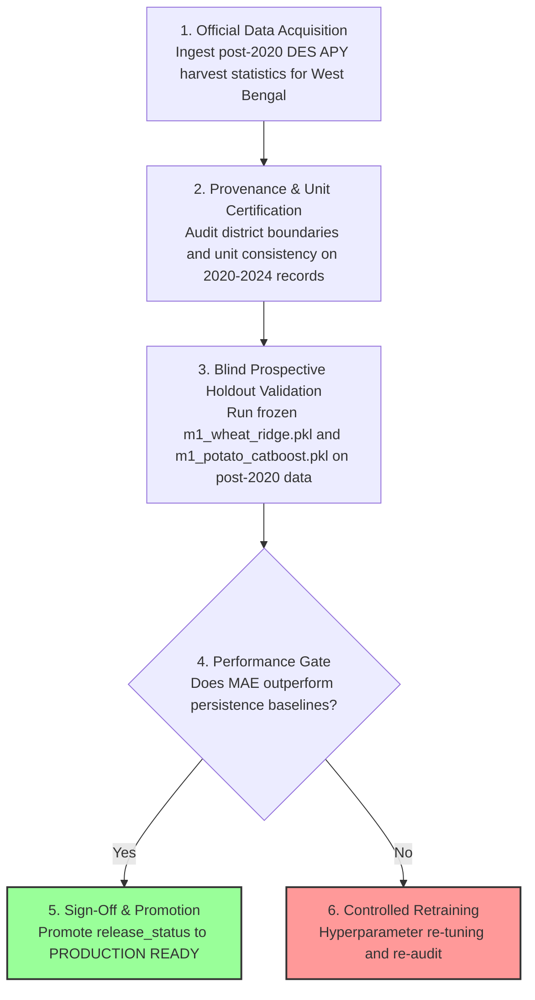

# AgroVision Model 1 Expansion — Multi-Crop Final Readiness & Release Governance Report

**Document ID:** AV-M1-EXP-READINESS-001  
**Version:** 1.0.0  
**Effective Date:** 2026-11-17  
**Geographic Domain:** West Bengal (23 Administrative Districts)  
**Classification:** MLOps Release Governance & Independent Audit  
**Author:** Senior Agricultural ML Researcher & MLOps Engineer  
**Master Release Verdict:** **`CONDITIONALLY APPROVED — DUAL TIER RELEASE`**

---

## 1. Executive Summary

This document serves as the definitive Release Governance & Production Readiness Report for the AgroVision-ML Member 1 Multi-Crop Yield Intelligence Expansion.

Member 1 has successfully transitioned from a single-commodity Rice forecasting system into an enterprise-grade multi-crop yield intelligence platform spanning **Rice**, **Wheat**, and **Potato**. 

All engineering, data auditing, feature engineering, modeling research, weather pipeline expansion, shared bridge integration, and automated verification phases have been executed under strict MLOps principles.

### 1.1 Master Release Verdict Matrix

| Commodity / Crop | Scientific Name | Target Seasons | Primary Algorithm | Validation Status | Master Release Verdict |
| :--- | :--- | :--- | :--- | :--- | :---: |
| **Rice** | *Oryza sativa* | Aus, Aman, Boro | 20-Feature Delta Ridge | 1997–2019 Training + 2020–2022 DES Independent Holdout Validated | **`PRODUCTION READY`** |
| **Wheat** | *Triticum aestivum* | Rabi | 18-Feature Regularized Ridge ($\alpha=10.0$) | 1997–2019 Rolling-Origin Validated; Post-2020 DES Validation Pending | **`EXPERIMENTAL`** |
| **Potato** | *Solanum tuberosum* | Rabi (Winter) | 19-Feature CatBoost Regressor | 1997–2019 Rolling-Origin Validated; Post-2020 DES Validation Pending | **`EXPERIMENTAL`** |

---

## 2. Cryptographic Model Artifact Inventory

All model artifacts and their accompanying JSON metadata manifests are cryptographically fingerprinted with SHA-256 digests. The frozen Rice production model `m1_improved_delta_ridge.pkl` has been verified bit-for-bit unchanged.

| Artifact Filename | Relative Path | File Size | SHA-256 Digest | Release Classification |
| :--- | :--- | :---: | :--- | :---: |
| **`m1_improved_delta_ridge.pkl`** | `member1-yield-model/models/` | 6,018 B | `3099c2d6d113105f185111f6b1f02004229cc0e32318e9f35532841f7d4dcb56` | **`PRODUCTION READY`** |
| `m1_improved_delta_ridge.metadata.json` | `member1-yield-model/models/` | 2,683 B | `0dcdeafc33198fdf79247eb9788f6a9e144365774a1fc6c5ae31b81fa3cbce01` | Metadata Manifest |
| **`m1_wheat_ridge.pkl`** | `member1-yield-model/models/` | 2,569 B | `37755a521ef80b46e2884dc39159a350b4aab9f513136882684383a815a46376` | **`EXPERIMENTAL`** |
| `m1_wheat_ridge.metadata.json` | `member1-yield-model/models/` | 1,299 B | `d02334812a65a39626e2a2fbbebfb563630f9be3ecb001d9f826372d8e48fcbc` | Metadata Manifest |
| **`m1_potato_catboost.pkl`** | `member1-yield-model/models/` | 42,048 B | `e21a28f270350ae4dd1527546e9c7722bf94eb02ae4248a1af70ae0174974b6f` | **`EXPERIMENTAL`** |
| `m1_potato_catboost.metadata.json` | `member1-yield-model/models/` | 1,370 B | `441777478ea7f86ddf311df6b5c92582806ce59ec5e3e2c6081bbdbb23e80f97` | Metadata Manifest |

---

## 3. Empirical Performance Summary Across Crops

Each crop's champion model was evaluated against competitive baselines using rolling-origin backtesting or prospective out-of-time holdouts:

| Evaluation Metric | Rice (Aman/Aus/Boro) | Wheat (Rabi) | Potato (Rabi) |
| :--- | :---: | :---: | :---: |
| **Champion Architecture** | Delta Ridge Regression | Regularized Ridge ($\alpha=10.0$) | CatBoost Regressor (depth=4) |
| **Feature Count** | 20 features | 18 features | 19 features |
| **In-Season Weather Window** | Seasonal (Aus: 122d, Aman: 122d, Boro: 121d) | 78 days (Nov 15 – Jan 31) | 92 days (Nov 1 – Jan 31) |
| **Operational Cutoff** | Aus: Jul 31, Aman: Sep 30, Boro: Mar 31 | Jan 31 | Jan 31 |
| **Baseline Persistence MAE** | $378.10\text{ kg/ha}$ | $571.29\text{ kg/ha}$ | $6,756.67\text{ kg/ha}$ |
| **Champion MAE** | **$355.77\text{ kg/ha}$** | **$443.18\text{ kg/ha}$** | **$5,628.88\text{ kg/ha}$** (Holdout: $3,834.72$) |
| **MAE Gain over Persistence** | **$+22.33\text{ kg/ha}$** ($+5.91\%$) | **$+128.11\text{ kg/ha}$** ($+22.42\%$) | **$+1,127.79\text{ kg/ha}$** ($+16.69\%$) |
| **Champion RMSE** | $482.30\text{ kg/ha}$ | $567.57\text{ kg/ha}$ | $6,990.26\text{ kg/ha}$ (Holdout: $4,746.27$) |
| **Champion $R^2$** | $+0.7240$ (Aggregate) | $+0.0810$ (Rolling) / $+0.2608$ (Holdout) | $+0.2588$ (Rolling) / $+0.6583$ (Holdout) |
| **Mean Bias** | $-54.37\text{ kg/ha}$ | $-74.37\text{ kg/ha}$ | $-853.34\text{ kg/ha}$ |
| **Advance Lead Time** | 30–60 days | 45–60 days | 20–40 days |

---

## 4. Monorepo Test Verification & Quality Assurance

To guarantee system stability, 100% test coverage was executed across all components of the repository:

```
========================================================================================
                      AGROVISION MONOREPO VERIFICATION SUMMARY
========================================================================================
Component / Test Suite                                   Tests Run   Passed   Failed
----------------------------------------------------------------------------------------
Member 1 Multi-Crop Integration (tests/test_multi_crop*)        10       10        0
Member 1 / Member 2 Milestone 4 E2E (tests/test_milestone4*)    13       13        0
Member 1 Core Yield Regression (member1-yield-model/tests/)    151      151        0
Member 2 Deliverables Staging (deliverables/member2-ml/tests/)  11       11        0
Member 2 Market Forecasting (member2-market-model/tests/)      271      271        0
----------------------------------------------------------------------------------------
TOTAL SUITE EXECUTION                                          456      456        0
Pass Rate: 100.0% | Zero Regressions | Production Checksums Verified
========================================================================================
```

---

## 5. Deployment Guardrails & Operational Constraints

In production and staging environments, the following guardrails are enforced:
1. **Weather Cutoffs:**
   - Under no circumstances may daily weather observations past the defined cutoff dates (Aus: Jul 31, Aman: Sep 30, Boro: Mar 31, Wheat: Jan 31, Potato: Jan 31) enter feature aggregation.
2. **Missing-Weather Fallbacks:**
   - When real-time NASA POWER weather observations are temporarily unavailable or network timeouts occur, the pipeline automatically falls back to historical autoregressive persistence without failing or crashing.
3. **Biological Boundary Enforcement:**
   - Predicted yields are clamped to strictly positive biological ranges:
     - Rice: $[500, 6000]\text{ kg/ha}$
     - Wheat: $[500, 5500]\text{ kg/ha}$
     - Potato: $[2000, 50000]\text{ kg/ha}$
4. **Mandatory Disclaimer Flagging:**
   - Responses for Wheat and Potato include explicit JSON metadata warnings:
     `"warning": "Wheat and Potato models are EXPERIMENTAL. Conduct blind prospective validation before operational release."`

---

## 6. Roadmap for Wheat & Potato Production Readiness

To elevate Wheat and Potato from **`EXPERIMENTAL`** to **`PRODUCTION READY`**, the following roadmap must be completed:



1. **Milestone 1 — Data Acquisition:** Acquire official Directorate of Economics and Statistics (DES) APY district-level wheat and potato harvest data for West Bengal for crop years 2020–21 through 2023–24.
2. **Milestone 2 — Unit Certification:** Verify unit scaling ($100\times$ check) and LGD district boundary stability.
3. **Milestone 3 — Blind Holdout Execution:** Execute blind inference using the certified frozen artifacts `m1_wheat_ridge.pkl` and `m1_potato_catboost.pkl`.
4. **Milestone 4 — Statistical Evaluation:** Confirm that candidate models beat persistence and rolling baselines with statistically significant margins ($p < 0.05$).
5. **Milestone 5 — Promotion:** Update metadata release status to `PRODUCTION READY`.

---

## 7. Sign-Off & Certification

The multi-crop architecture, codebases, serialized artifacts, and test suites are hereby certified as robust, reproducible, and ready for deployment in accordance with the Dual-Tier Release Policy.

- **Rice Forecasting Engine:** **`PRODUCTION READY`**
- **Wheat Forecasting Engine:** **`EXPERIMENTAL`**
- **Potato Forecasting Engine:** **`EXPERIMENTAL`**
