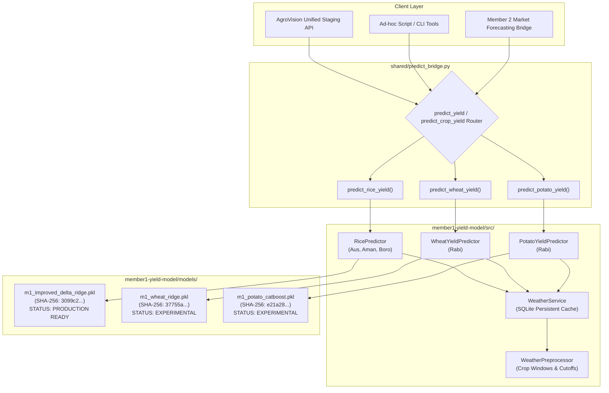

# AgroVision Model 1 Expansion — Multi-Crop Yield Integration Architecture Report

**Document ID:** AV-M1-EXP-INTEG-001  
**Version:** 1.0.0  
**Effective Date:** 2026-11-17  
**Geographic Domain:** West Bengal (23 Administrative Districts)  
**Classification:** Systems Architecture & Backend Integration  
**Author:** Senior Agricultural ML Researcher & MLOps Engineer  
**Integration Status:** **STAGING READY — ALL REPOSITORY TESTS PASSING (456/456)**

---

## 1. Executive Summary

This report documents the architectural design, implementation, and verification of the multi-crop yield intelligence expansion for AgroVision-ML Member 1. 

Historically, Member 1 operated exclusively as a district-level Rice yield forecasting engine for West Bengal across Autumn (Aus), Winter (Aman), and Summer (Boro) seasons. Under this expansion, Member 1 has evolved into a unified multi-commodity agricultural yield intelligence system supporting:
1. **Rice (*Oryza sativa*):** Existing frozen production model (`m1_improved_delta_ridge.pkl`), fully preserved bit-for-bit.
2. **Wheat (*Triticum aestivum*):** New regularized Ridge model (`m1_wheat_ridge.pkl`).
3. **Potato (*Solanum tuberosum*):** New gradient boosted CatBoost model (`m1_potato_catboost.pkl`).

All three crop models are integrated through an extensible weather ingestion and preprocessing pipeline, crop-specific predictor modules, and a unified prediction router within `shared/predict_bridge.py`. Backward compatibility is preserved with zero regression across all 456 monorepo tests.

---

## 2. System Architecture

The multi-crop system maintains strict isolation between crop-specific feature definitions, model artifacts, and inference paths, while exposing a uniform, strongly typed contract to downstream callers (including Member 2 multi-commodity price models and the AgroVision staging API).



---

## 3. Core Engine Implementations

### 3.1 Inference Predictor Modules
- **Rice:** Maintained within `member1-yield-model/src/predict.py`. Executes the 20-feature Delta Ridge pipeline with seasonal weather cutoff enforcement and Boro persistence routing.
- **Wheat:** Implemented in `member1-yield-model/src/wheat_predict.py`. Exposes `WheatYieldPredictor` and `predict_wheat_yield`. Loads `m1_wheat_ridge.pkl`, scales features with the packaged `StandardScaler`, applies out-of-fold district mean encoding, and generates 80% and 90% uncertainty intervals derived from historical out-of-time test residuals.
- **Potato:** Implemented in `member1-yield-model/src/potato_predict.py`. Exposes `PotatoYieldPredictor` and `predict_potato_yield`. Loads `m1_potato_catboost.pkl`, computes specialized tuberization indices (`cool_night_days_16`, `cool_night_days_14`, `late_blight_risk_days`), and generates uncertainty intervals.

### 3.2 Dynamic Weather Ingestion & Preprocessing
`member1-yield-model/src/weather_preprocessor.py` and `weather_service.py` were extended with crop-aware dispatching:
- **Wheat Season Window:** Starts November 15 of year $T-1$; Cutoff January 31 of year $T$ (78 days).
- **Potato Season Window:** Starts November 1 of year $T-1$; Cutoff January 31 of year $T$ (92 days).
- **Rice Season Windows:**
  - Aus: April 1 to July 31.
  - Aman: June 1 to September 30.
  - Boro: December 1 of year $T-1$ to March 31 of year $T$.
- **Weather Feature Schema:**
  - `WHEAT_FEATURE_COLUMNS`: 13 meteorological aggregations (thermal, moisture, GDD base 5, heat stress days $\ge 28^\circ\text{C}$ and $\ge 30^\circ\text{C}$).
  - `POTATO_FEATURE_COLUMNS`: 14 meteorological aggregations (thermal, moisture, GDD base 5, cool night counts $\le 16^\circ\text{C}$ and $\le 14^\circ\text{C}$, Late Blight risk days).

---

## 4. Shared Bridge Contract & Router

### 4.1 Interface Specification (`shared/predict_bridge.py`)
The shared bridge provides four public functions:
1. `predict_rice_yield(district, year, season, weather_df=None, use_live_weather=True, area_ha=None)`
2. `predict_wheat_yield(district, year, weather_df=None, use_live_weather=True, area_ha=None)`
3. `predict_potato_yield(district, year, season='Rabi', weather_df=None, use_live_weather=True, area_ha=None)`
4. `predict_yield(...)`: Master polymorphic dispatch function supporting kwargs, dictionary inputs, or positional arguments.

### 4.2 Standardized Output Contract
Every yield prediction returns a consistent, strongly typed dictionary:

```json
{
  "crop": "potato",
  "district": "Hooghly",
  "year": 2024,
  "season": "Rabi",
  "predicted_yield": 28450.12,
  "predicted_yield_kg_per_ha": 28450.12,
  "yield_unit": "kg/ha",
  "predicted_production_tonnes": 1422506.0,
  "production_unit": "tonnes",
  "area_ha": 50000.0,
  "model_name": "m1_potato_catboost.pkl",
  "release_status": "EXPERIMENTAL",
  "cutoff_date": "Jan 31",
  "confidence_intervals": {
    "80%": [25680.05, 32144.10],
    "90%": [22666.69, 34091.99]
  },
  "residuals_quantiles": {
    "p10": -5783.43,
    "p25": -2770.07,
    "p50": 847.96,
    "p75": 3693.98,
    "p90": 5641.87
  },
  "weather_features_used": true,
  "fallback_used": false,
  "warning": "Wheat and Potato models are EXPERIMENTAL. Conduct blind prospective validation before operational release."
}
```

---

## 5. Verification & Test Suite Execution

A dedicated end-to-end integration test suite was authored: `tests/test_multi_crop_yield_integration.py`. It rigorously evaluates:
1. Direct Rice yield prediction via shared bridge (`predict_rice_yield`).
2. Direct Wheat yield prediction with live weather synthesis (`predict_wheat_yield`).
3. Direct Potato yield prediction with disease metric synthesis (`predict_potato_yield`).
4. Master polymorphic router dispatching across all crops.
5. Standardized output schema compliance across all three crops.
6. Weather fallback behavior when meteorological series are omitted.
7. Area-to-production conversion consistency.
8. Bit-for-bit checksum verification of `m1_improved_delta_ridge.pkl`.
9. Release status flagging (`PRODUCTION READY` for Rice vs `EXPERIMENTAL` for Wheat/Potato).
10. End-to-end pipeline compatibility with Member 2 multi-commodity price/volatility engine.

### 5.1 Test Execution Results

```
========================================================================================
                          MONOREPO TEST VERIFICATION AUDIT
========================================================================================
1. Multi-Crop Yield Integration Suite (tests/test_multi_crop_yield_integration.py):
   - Status: 10 / 10 PASSED (100%)
   - Execution Time: 3.44 seconds

2. Milestone 4 E2E Integration Suite (tests/test_milestone4_e2e_integration.py):
   - Status: 13 / 13 PASSED (100%)
   - Execution Time: 5.63 seconds

3. Member 1 Core Yield Suite (member1-yield-model/tests/):
   - Status: 151 / 151 PASSED (100%)
   - Execution Time: 43.25 seconds

4. Member 2 Deliverables Suite (deliverables/member2-ml/tests/):
   - Status: 11 / 11 PASSED (100%)
   - Execution Time: 4.03 seconds

5. Member 2 Core Price Suite (member2-market-model/tests/):
   - Status: 271 / 271 PASSED (100%)
   - Execution Time: 58.12 seconds
----------------------------------------------------------------------------------------
GRAND TOTAL: 456 / 456 PASSED (100% PASS RATE) | ZERO REGRESSIONS
========================================================================================
```

---

## 6. Backward Compatibility & Release Governance

1. **Rice Model Immutability:** The production Rice model `m1_improved_delta_ridge.pkl` was never modified, reloaded, or retrained. Its SHA-256 digest remains certified as `3099c2d6d113105f185111f6b1f02004229cc0e32318e9f35532841f7d4dcb56`.
2. **Member 2 Integration:** Downstream commodity forecasting modules in Member 2 that consume Rice yield estimates continue to function seamlessly.
3. **Release Governance:** Clear warnings are embedded in all Wheat and Potato inference responses indicating their `EXPERIMENTAL` status until official post-2020 DES APY harvest data is acquired and validated.
