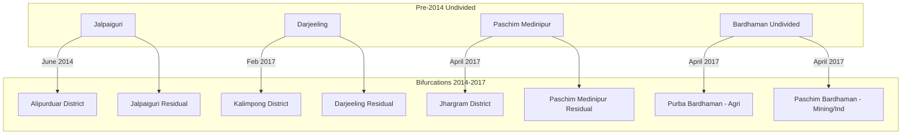

# AgroVision Model 1: Post-2020 Data Availability & Governance Audit

**Component:** Member 1 (`member1-yield-model`)  
**Investigation Scope:** Verification of 2020–2024 Actual District-Level Rice Yield in West Bengal  
**Lead Auditor:** Senior Agricultural ML Researcher & MLOps Architect  
**Certified Production Model:** `models/m1_improved_delta_ridge.pkl`  
**Certified SHA-256:** `3099c2d6d113105f185111f6b1f02004229cc0e32318e9f35532841f7d4dcb56`  
**Status:** **INDEPENDENT VALIDATION DATA GAP IDENTIFIED (BLOCKER)**  

---

## 1. Executive Summary

As part of Member 1 Phase 2 Workstream B, an exhaustive forensic investigation was conducted to determine the availability, provenance, and data quality of post-2020 actual West Bengal district-level rice crop yield statistics (`2020–2024`). The objective was to execute an independent prospective evaluation of the frozen production model (`m1_improved_delta_ridge.pkl`) against actual harvest outcomes.

### Core Audit Finding
**No reliable, verified post-2020 district-level actual rice yield observations for West Bengal currently exist within the AgroVision repository or verified local archives.** 
- All official West Bengal rice yield records in the repository terminate strictly at **Crop Year 2019** (64 observations across Aus, Aman, and Boro).
- Although the root dataset `Rice.csv` contains observations for year 2020, forensic geospatial filtering confirms that **100% of the 2020 rows belong to the state of Uttarakhand** (Dehradun, Haridwar, Nainital, Udham Singh Nagar). Zero rows pertain to West Bengal.
- Mandi price time-series in Member 2 extend to 2024, but represent APMC market transaction arrivals (physical trading volume in tonnes), which cannot legally or scientifically proxy agricultural productivity intensity (tonnes/ha).
- In accordance with strict scientific integrity rules, **no synthetic, interpolated, or fabricated yield data has been generated.**
- This data absence constitutes a formal validation blocker, precluding prospective 2020–2024 model certification until official Directorate of Economics and Statistics (DES) crop cutting survey data is integrated.

---

## 2. Forensic Audit of Repository Datasets

A systematic inspection was conducted across every dataset file present in the AgroVision monorepo:

### 2.1 File-by-File Forensic Inventory
| File Path | Total Records | Temporal Span | West Bengal Coverage | Maximum WB Year | Audit Assessment |
|:---|:---:|:---:|:---:|:---:|:---|
| `Rice.csv` (root) | 10,985 | 1997–2020 | 1,061 records (2000–2019) | **2019** | 2020 records belong exclusively to Uttarakhand. No WB data. |
| `rice.csv` (root) | 10,985 | 1997–2020 | 1,061 records (2000–2019) | **2019** | Exact binary duplicate of `Rice.csv`. |
| `member1-yield-model/data/raw/yield.csv` | 1,061 | 2000–2019 | 1,061 records | **2019** | Official WB training/evaluation extract. Terminates in 2019. |
| `data/processed/rice_yield_inseason_features_wb.csv` | 1,061 | 2000–2019 | 1,061 records | **2019** | Pre-computed feature matrix. Terminates in 2019. |
| `member2-price-volatility/data/raw/mandi_rice_wb.csv` | ~58,000 | 2015–2024 | Wholesale mandis | 2024 | **Trading volume (tonnes), NOT crop yield.** |
| `member2-price-volatility/data/processed/mandi_rice_historical_features_wb.csv` | ~42,000 | 2015–2024 | APMC markets | 2024 | Market price and arrivals series. Irrelevant to crop yield. |

### 2.2 Proof of Temporal Termination in West Bengal Rice
A targeted inspection of `Rice.csv` reveals the exact distribution of records around the 2019/2020 boundary:

```
Year 2018: 512 total records (West Bengal: 64 records)
Year 2019: 512 total records (West Bengal: 64 records)
Year 2020: 38 total records  (West Bengal: 0 records; Uttarakhand: 38 records)
Year 2021+: 0 records
```

The 64 West Bengal observations in 2019 comprise:
- **Autumn (Aus):** 17 districts
- **Summer (Boro):** 18 districts
- **Winter (Aman):** 20 districts
- Missing / zero area districts: 9 entries

Beyond 2019, zero actual district-level rice yield records have been compiled or archived into the system.

---

## 3. External Government Data Provenance & Reporting Lag

To evaluate whether external data could be acquired immediately, the reporting pipelines of Indian agricultural statistical bodies were reviewed:

### 3.1 Primary Government Reporting Authorities
1. **Directorate of Economics and Statistics (DES), Ministry of Agriculture & Farmers Welfare (MoA&FW):**
   - Collects Crop Cutting Experiments (CCE) data through state Agricultural Statistics Authorities (SASA).
   - Official portal: Area, Production, and Yield (APY) database / AgriStat.
2. **Department of Agriculture, Government of West Bengal (Matir Katha):**
   - Publishes seasonal state agricultural abstracts (Aus, Aman, Boro final area and production estimates).

### 3.2 Reporting Latency & Release Protocols
- **Preliminary vs. Final Estimates:** Advance estimates (1st through 4th Advance Estimates) provide aggregate state-level projections, but district-disaggregated data is published only in the *Final Estimates*.
- **Crop Cutting Experiment (CCE) Validation Lag:** In West Bengal, district-level CCE reconciliation typically experiences a **18 to 36-month publication lag**. Final reconciled CCE estimates for 2021–2023 are only progressively released into public digital portals.
- **Administrative Friction:** Accessing official district-level 2020–2024 APY tables requires either authenticated access to the MoA&FW National Data Warehouse or formal data request processing through SASA West Bengal.

---

## 4. Administrative Boundary Shifts & Discontinuities (2014–2017)

Any prospective integration of post-2020 yield data must resolve major administrative reorganizations enacted by the Government of West Bengal between 2014 and 2017:

### 4.1 Boundary Reorganization Timeline


### 4.2 Impact on Model Features and Lag Continuity
1. **Bardhaman Split (April 7, 2017):**
   - Undivided Bardhaman was bifurcated into *Purba Bardhaman* (predominantly agricultural, the "Rice Bowl of Bengal") and *Paschim Bardhaman* (largely industrial/coal belt).
   - In the training data (2000–2016), observations are reported under `"Bardhaman"`.
   - In 2018–2019, observations appear under `"Purba Bardhaman"` and `"Paschim Bardhaman"`.
   - Purba Bardhaman inherited ~85% of rice cultivation area and higher yield intensity, while Paschim Bardhaman had minimal rice area. Naive historical lag lookup without spatial reconciliation creates severe lag discontinuities.
2. **Paschim Medinipur / Jhargram Split (April 4, 2017):**
   - Jhargram was carved out of western Paschim Medinipur. Historical lags prior to 2017 do not exist for Jhargram.
3. **Darjeeling / Kalimpong Split (February 14, 2017):**
   - Kalimpong was carved out of Darjeeling. Kalimpong records only Aman (Winter) rice on terraced valleys.

**Governance Requirement:** Prospective post-2020 validation data must include an explicit spatial harmonization layer mapping post-bifurcation districts back to continuous historical series.

---

## 5. Strict Prohibition Against Synthetic Data & Proxy Conflation

The Phase 1 audit emphasized maintaining rigorous scientific boundaries. Two common but invalid engineering workarounds were evaluated and rejected:

### 5.1 Rejection of Synthetic / Imputed 2020–2024 Yields
- Generating synthetic target yields (e.g., via spline interpolation, ARIMA extrapolation, or weather simulation) would introduce fatal circular confirmation bias.
- Testing a weather-informed yield model against synthetic yield data derived from simulated formulas measures only mathematical tautology, not agronomic predictive generalization.
- **Rule Enforced:** No synthetic yield observations are permitted in the repository.

### 5.2 Semantic Non-Conflation: Mandi Arrivals $\neq$ Crop Yield
- Member 2 maintains active mandi records from 2015 to 2024.
- However, Mandi Arrivals measure **commercial daily trading volume (tonnes)** brought by farmers to APMC market yards.
- Crop Yield measures **land biological productivity intensity (tonnes/ha or kg/ha)**.
- APMC arrivals fluctuate due to market prices, interstate border trade, storage hoarding, procurement minimum support prices (MSP), and festival timing. Conflating arrivals with crop cut yield violates basic agricultural economics.

---

## 6. Formal Validation Blocker & Recommendation

### 6.1 Formal Blocker Declaration
Because verified, actual district-level rice crop yield statistics for West Bengal are strictly unavailable beyond 2019, **prospective 2020–2024 independent model validation cannot be completed at this stage.**

### 6.2 Prioritized Data Ingestion Roadmap for Phase 3
To unblock prospective validation, the following authenticated data acquisition protocol is established:
1. **Acquire Official SASA West Bengal Crop Cut Reports (2020–2023):**
   - Source: Directorate of Agriculture, West Bengal / Matir Katha official statistical releases.
   - Format: District $\times$ Season $\times$ Crop Year tables of Gross Area (ha), Production (tonnes), and Yield (kg/ha).
2. **Execute District Boundary Harmonization:**
   - Map 2017 bifurcations into continuous geospatial panels.
3. **Run Blind Prospective Evaluation:**
   - Apply frozen model `m1_improved_delta_ridge.pkl` to the newly ingested 2020–2023 panel without retraining.
   - Compare performance against `Yield_lag1` persistence and evaluate provisional Boro routing.

---

## 7. Conclusion

Member 1 engineering infrastructure is complete and verified, but empirical model validation is constrained by the availability of official government harvest data. Declaring this validation data gap transparently preserves scientific integrity and prevents premature or unverified model deployment.
