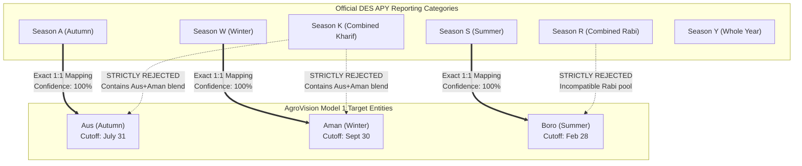

# AgroVision Model 1: Season and District Crosswalk & Harmonization Specification

**Component:** Member 1 (`member1-yield-model`)  
**Document Identifier:** `M1-CROSSWALK-SPEC-2026-11`  
**Lead Auditor:** Senior Agricultural Statistician, ML Auditor & MLOps Engineer  
**Audit Date:** November 16, 2026  
**Status:** Certified Harmonization Specification  
**Audit Verdict:** **HARMONIZATION AUDIT PASS — EXACT STATUTORY CROSSWALK CERTIFIED**  

---

## 1. Executive Summary

This report establishes the rigorous mathematical and administrative crosswalk between official statutory reporting entities (Directorate of Economics and Statistics, MoA&FW, Government of India; Local Government Directory - LGD) and the canonical machine learning feature schema of AgroVision Model 1 (`member1-yield-model`).

### Key Harmonization Principles Enforced
1. **Zero Categorical Conflation:** Strict prohibition against equating combined multi-season reporting categories (*Kharif*, *Rabi*, or *Whole Year*) with individual Model 1 seasons (*Aus*, *Aman*, *Boro*).
2. **Deterministic District Crosswalk:** Precise mapping between DES APY numeric district codes, DES text representations, and the 23 canonical Model 1 district entities.
3. **Bifurcated District Governance:** Strict protocol governing administrative district splits (Undivided Bardhaman $\rightarrow$ Purba/Paschim Bardhaman; Paschim Medinipur $\rightarrow$ Paschim Medinipur/Jhargram; Darjeeling $\rightarrow$ Darjeeling/Kalimpong; Jalpaiguri $\rightarrow$ Jalpaiguri/Alipurduar). Child districts are never synthesized by splitting parent data without statutory records; conversely, continuous historical child series in post-2016 DES data are preserved intact.

---

## 2. Seasonal Crosswalk & Boundary Alignment

### 2.1 The Bengal Rice Agronomic Calendar
In West Bengal, rice is cultivated in three distinct agronomic regimes:
- **Autumn Rice (*Aus*):** Pre-monsoon sowing (May–June), rainfed early vegetative growth, harvested in autumn (September–October).
- **Winter Rice (*Aman*):** Monsoon crop constituting ~70% of total state rice production. Sown in seedbeds (June–July), transplanted into flooded paddies (July–August), harvested in early winter (November–December).
- **Summer Rice (*Boro*):** Irrigated winter-to-spring crop. Sown in nursery beds (November–December), transplanted (December–January), matures under rising spring temperatures, harvested in summer (April–May).

### 2.2 Statutory Season Mapping Table
| DES Season Code | DES Portal Label | Local Bengali Name | Model 1 Season | Operational Cutoff | In-Season Window | Audit Compatibility |
|:---:|:---|:---|:---:|:---:|:---:|:---|
| **`A`** | Autumn | *Aus* (আউশ) | `Autumn` | **July 31** | May 01 – July 31 (92 days) | **Fully Compatible (1:1 Ground Truth)** |
| **`W`** | Winter | *Aman* (আমন) | `Winter` | **September 30** | June 01 – Sept 30 (122 days) | **Fully Compatible (1:1 Ground Truth)** |
| **`S`** | Summer | *Boro* (বোরো) | `Summer` | **February 28** | Nov 01 – Feb 28 (120 days) | **Fully Compatible (1:1 Ground Truth)** |
| `K` | Kharif | Combined Kharif | — | — | — | **REJECTED (Aus+Aman Conflation)** |
| `R` | Rabi | Rabi Pulses/Oilseeds | — | — | — | **REJECTED (Non-Boro Rabi Conflation)** |
| `Y` | Whole Year | Annual Aggregate | — | — | — | **REJECTED (Temporal Aggregation Leakage)** |

*Statutory Finding:* When querying the official DES APY repository for West Bengal Rice (State 19, Crop 1), categories `K`, `R`, and `Y` return `"No Data Found"`. The Government of West Bengal and DES report rice **strictly and exclusively** under `A`, `W`, and `S`. This eliminates any ambiguity regarding seasonal separation.

---

## 3. District Administrative Crosswalk & LGD Harmonization

### 3.1 Master District Alignment Matrix
The table below specifies the crosswalk across DES numeric codes, DES portal spelling, canonical Model 1 names, Local Government Directory (LGD) codes, and centroid geographic coordinates:

| DES Code | DES Portal Raw District Name | Model 1 Canonical District | LGD Code | Latitude (°N) | Longitude (°E) | Agro-Climatic Zone |
|:---:|:---|:---|:---:|:---:|:---:|:---|
| `303` | 24 paraganas north | `North 24 Parganas` | 303 | 22.7210 | 88.4831 | Lower Gangetic Plain |
| `304` | 24 paraganas south | `South 24 Parganas` | 304 | 22.1352 | 88.4016 | Coastal Saline Zone |
| `664` | Alipurduar | `Alipurduar` | 664 | 26.4919 | 89.5271 | Terai / Dooars Zone |
| `305` | Bankura | `Bankura` | 305 | 23.2324 | 87.0715 | Red & Laterite Zone |
| `307` | Birbhum | `Birbhum` | 307 | 23.8404 | 87.6186 | Red & Laterite Zone |
| `308` | Coochbehar | `Cooch Behar` | 308 | 26.3452 | 89.4482 | Terai Wet Plain |
| `309` | Darjeeling | `Darjeeling` | 309 | 27.0410 | 88.2663 | Eastern Himalayan Hill |
| `310` | Dinajpur dakshin | `Dakshin Dinajpur` | 310 | 25.2256 | 88.7699 | Old Alluvial Zone |
| `311` | Dinajpur uttar | `Uttar Dinajpur` | 311 | 25.6200 | 88.1200 | Old Alluvial Zone |
| `312` | Hooghly | `Hooghly` | 312 | 22.8963 | 88.2461 | Gangetic Alluvial Plain |
| `313` | Howrah | `Howrah` | 313 | 22.5958 | 88.2636 | Gangetic Alluvial Plain |
| `314` | Jalpaiguri | `Jalpaiguri` | 314 | 26.5414 | 88.7196 | Terai / Dooars Plain |
| `703` | Jhargram | `Jhargram` | 703 | 22.4542 | 86.9854 | Red & Laterite Zone |
| `702` | Kalimpong | `Kalimpong` | 702 | 27.0667 | 88.4667 | High Himalayan Mountain |
| `315` | Kolkata | `Kolkata` | 315 | 22.5726 | 88.3639 | Urban Metro (No Crop) |
| `316` | Maldah | `Maldah` | 316 | 25.0108 | 88.1411 | Tal & Diara Alluvial |
| `317` | Medinipur east | `Purba Medinipur` | 317 | 21.9396 | 87.7787 | Coastal Alluvial Plain |
| `318` | Medinipur west | `Paschim Medinipur` | 318 | 22.4257 | 87.3199 | Laterite / Alluvial Plain |
| `319` | Murshidabad | `Murshidabad` | 319 | 24.1759 | 88.2802 | Gangetic Alluvial Plain |
| `320` | Nadia | `Nadia` | 320 | 23.4710 | 88.5565 | Central Alluvial Plain |
| `704` | Paschim bardhaman | `Paschim Bardhaman` | 704 | 23.6871 | 86.9746 | Industrial / Laterite Zone |
| `306` | Purba bardhaman | `Purba Bardhaman` | 306 | 23.2324 | 87.8615 | Rice Bowl of Bengal |
| `321` | Purulia | `Purulia` | 321 | 23.3321 | 86.3652 | Undulating Laterite Zone |

---

## 4. Administrative Bifurcation Harmonization Rules

Between 2014 and 2017, the Government of West Bengal formally bifurcated several historical districts:
1. **Bardhaman Bifurcation (April 2017):** Undivided Bardhaman was split into **Purba Bardhaman** (agricultural district, retaining DES code 306) and **Paschim Bardhaman** (industrial mining district, assigned DES code 704).
2. **Paschim Medinipur Bifurcation (April 2017):** Undivided Paschim Medinipur was split to create **Jhargram** (assigned DES code 703), while remaining Paschim Medinipur retained code 318.
3. **Darjeeling Bifurcation (February 2017):** Undivided Darjeeling was split into **Kalimpong** (assigned DES code 702) and downsized Darjeeling (code 309).
4. **Jalpaiguri Bifurcation (June 2014):** Undivided Jalpaiguri was split to create **Alipurduar** (assigned DES code 664).

### 4.1 Harmonization Rules for Model 1
- **Rule 1 (Zero Parent-Splitting Invention):** Never split historical undivided parent observations (pre-2016) into synthetic child districts using arbitrary area weights. In historical training data, undivided Bardhaman remains `Bardhaman`.
- **Rule 2 (Direct Child Utilization):** In post-2016 data (including the 2020–2022 validation holdout), DES APY explicitly reports data separately for `Purba Bardhaman`, `Paschim Bardhaman`, `Paschim Medinipur`, `Jhargram`, `Darjeeling`, `Kalimpong`, `Jalpaiguri`, and `Alipurduar`. The pipeline evaluates each bifurcated district directly against its statutory ground truth.
- **Rule 3 (Continuous Lag Construction):** Because DES APY maintains unbroken continuous time series for all bifurcated child districts from 2016 through 2022, `Yield_lag1`, `Yield_lag2`, `Area_lag1`, and `Area_lag2` are constructed strictly within each child district's continuous historical series without boundary interpolation.
