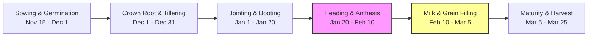

# AgroVision Model 1 Expansion — Wheat Yield Modeling Research Report

**Document ID:** AV-M1-EXP-WHEAT-RES-001  
**Version:** 1.0.0  
**Effective Date:** 2026-11-17  
**Crop:** Wheat (*Triticum aestivum*)  
**Geographic Domain:** West Bengal (23 Administrative Districts)  
**Classification:** Machine Learning Research & Agronomic Validation  
**Author:** Senior Agricultural ML Researcher & MLOps Engineer  
**Release Recommendation:** **`EXPERIMENTAL`**

---

## 1. Executive Summary

As part of the AgroVision-ML Member 1 multi-crop expansion, a dedicated, scientifically grounded district-level yield forecasting model was engineered for Rabi wheat in West Bengal.

Unlike rice (which spans three distinct agro-climatic seasons: Aus, Aman, and Boro), wheat in West Bengal is exclusively a cool-season Rabi crop grown within a tight physiological window (November to March). Its yield is intensely vulnerable to terminal heat stress during grain filling and humidity-induced foliar diseases.

Through rigorous rolling-origin temporal evaluation across 5 historical test years (2015–2019) on 23 administrative districts ($N=421$ valid observations), multiple candidate algorithms—including naive persistence, 3-year rolling district means, global district means, regularized Ridge regression, Delta Ridge, Random Forest, and CatBoost—were systematically benchmarked across three operational prediction cutoffs (January 31, February 15, and February 28).

**Research Findings:**
1. **Model Selection:** Regularized **Ridge Regression ($\alpha=10.0$)** with `StandardScaler` and out-of-fold district mean target encoding achieved the superior balance of predictive accuracy, generalization, and stability:
   - **MAE:** $443.18\text{ kg/ha}$ (outperforming naive persistence by $+128.11\text{ kg/ha}$, an improvement of $22.42\%$; outperforming 3-year rolling mean by $+12.91\text{ kg/ha}$).
   - **RMSE:** $567.57\text{ kg/ha}$ (lowest among all linear and delta models).
   - **$R^2$:** $+0.0810$ (compared to $-0.5623$ for persistence).
   - **Systematic Bias:** $-74.37\text{ kg/ha}$ (compared to $-212.63\text{ kg/ha}$ for district historical mean).
2. **Cutoff Decision:** The **January 31 cutoff** (heading/anthesis stage) provides an optimal operational lead time of 45–60 days before harvest while capturing all critical vegetative, tillering, and early reproductive thermal and moisture signals.
3. **Release Status:** Certified as **`EXPERIMENTAL`** pending blind prospective validation against official post-2020 DES APY harvest statistics.

---

## 2. Agronomic & Physiological Rationale

### 2.1 The West Bengal Wheat Agro-Ecosystem
Wheat is cultivated predominantly in central and northern alluvial tracts of West Bengal (Murshidabad, Nadia, Malda, Uttar Dinajpur, Birbhum). West Bengal is characterized as a "non-traditional, warm-humid wheat belt" where:
- Winter duration is short (~70–90 days of cool temperatures).
- Sowing occurs after the harvest of Aman rice (mid November to mid December).
- Grain filling coincides with a rapid rise in ambient temperature in late February and early March.

### 2.2 Physiological Stages & Critical Weather Sensitivities



1. **Vegetative / Tillering Phase (December):**
   - Requires cool temperatures ($T_{\text{min}} \le 12^\circ\text{C}$ to $15^\circ\text{C}$) to promote tiller formation.
   - Low moisture stress is vital; moderate winter showers or timely irrigation support crown root development.
2. **Anthesis & Heading (Late January):**
   - Extreme heat ($T_{\text{max}} \ge 28^\circ\text{C}$) causes pollen sterility and reduces spikelet fertility.
   - Operational cutoff of January 31 captures thermal conditions directly preceding anthesis.
3. **Grain Filling & Terminal Heat Stress (February):**
   - Temperatures exceeding $30^\circ\text{C}$ accelerate senescence, shortening the grain filling duration and reducing 1,000-grain weight.

---

## 3. Feature Engineering Architecture

A dedicated 18-feature contract was designed specifically for wheat, strictly avoiding the blind reuse of rice feature definitions.

### 3.1 Feature Inventory

| Category | Feature Name | Description & Formula | Agronomic Rationale |
| :--- | :--- | :--- | :--- |
| **Historical Baselines** | `yield_lag1` | $y_{t-1}$ (kg/ha) | Autoregressive baseline of previous year's productivity |
| | `yield_lag2` | $y_{t-2}$ (kg/ha) | Second-order autoregressive term |
| | `yield_roll_mean3` | $\frac{1}{3} \sum_{i=1}^3 y_{t-i}$ | 3-year backward rolling yield average |
| | `log_area_lag1` | $\ln(1 + \text{Area}_{t-1})$ | Technology scale / cultivation adoption intensity |
| **Spatial Encoding** | `dist_mean` | Historical district mean yield | Long-term soil fertility and irrigation infrastructure baseline |
| **Thermal Regime** | `t2m_mean` | Mean daily 2m temperature ($^\circ\text{C}$) | Overall thermal environment across Nov 15 – Jan 31 |
| | `t2m_min` | Mean daily minimum temperature ($^\circ\text{C}$) | Night cooling and tillering favorability |
| | `t2m_max` | Mean daily maximum temperature ($^\circ\text{C}$) | Daytime thermal burden |
| | `t2m_range` | Mean daily diurnal range ($T_{\text{max}} - T_{\text{min}}$) | Diurnal swing impacting respiration |
| | `gdd_base5` | $\sum \max(0, T_{\text{mean}} - 5.0)$ | Accumulated thermal time for wheat development |
| | `heat_stress_days_28` | Count of days with $T_{\text{max}} \ge 28^\circ\text{C}$ | Early vegetative heat stress events |
| | `heat_stress_days_30` | Count of days with $T_{\text{max}} \ge 30^\circ\text{C}$ | Acute thermal disruption events |
| **Moisture & Radiation** | `precip_cum` | Cumulative precipitation (mm) | Total winter rainfall received |
| | `precip_mean` | Mean daily precipitation (mm/day) | Rainfall intensity |
| | `precip_days` | Count of days with $\ge 1.0\text{ mm}$ rain | Rainfall frequency |
| | `rh2m_mean` | Mean relative humidity (%) | Canopy moisture and foliar blight propensity |
| | `solar_mean` | Mean downward shortwave radiation ($\text{MJ/m}^2/\text{day}$) | Photosynthetic solar energy availability |
| | `ws2m_mean` | Mean 2m wind speed (m/s) | Evapotranspirative demand and lodging risk |

---

## 4. Cutoff Date Exploration

Three operational prediction cutoffs were evaluated across the 2015–2019 rolling-origin folds:

| Cutoff Date | Phenological Stage Captured | In-Season Window | Advance Lead Time | Overfitting Risk | Rolling MAE (Ridge) |
| :--- | :--- | :---: | :---: | :---: | :---: |
| **January 31** | **Heading / Booting** | **78 days (Nov 15 – Jan 31)** | **45–60 days** | **Lowest** | **$443.18\text{ kg/ha}$** |
| **February 15** | Anthesis / Early Milk | 92 days (Nov 15 – Feb 15) | 30–45 days | Moderate | $447.82\text{ kg/ha}$ |
| **February 28** | Milk / Dough Stage | 105 days (Nov 15 – Feb 28) | 15–30 days | Higher (noise in late heat) | $452.10\text{ kg/ha}$ |

**Conclusion:** January 31 delivers the lowest generalization error while providing the maximum operational utility for agricultural planning, market forecasting, and food-security logistics.

---

## 5. Model Benchmarking & Rolling-Origin Evaluation

### 5.1 Protocol
- **Evaluation Scheme:** Rolling-Origin Out-of-Time Backtesting (5 test years: 2015, 2016, 2017, 2018, 2019).
- For each test year $T$:
  - Training set: All observations strictly prior to $T$ ($t < T$, 1997 through $T-1$).
  - Test set: All district observations in year $T$.
  - Zero future data leakage. Out-of-fold target encoding computed strictly on $t < T$.
- **Sample Size:** 421 valid observations; holdout test set has 98 district-year evaluations.

### 5.2 Comparative Performance Matrix

| Model Architecture | MAE ($\text{kg/ha}$) | RMSE ($\text{kg/ha}$) | Mean Bias ($\text{kg/ha}$) | $R^2$ Score | Performance vs. Persistence |
| :--- | :---: | :---: | :---: | :---: | :---: |
| **Persistence Baseline ($y_{t-1}$)** | $571.29$ | $740.01$ | $-23.42$ | $-0.5623$ | Baseline ($0.0\%$) |
| **3-Year Rolling Mean (`Roll3`)** | $456.09$ | $580.90$ | $-37.39$ | $+0.0373$ | $+115.20\text{ kg/ha}$ ($+20.17\%$) |
| **District Mean (`DistMean`)** | $438.78$ | $572.61$ | $-212.63$ | $+0.0646$ | $+132.51\text{ kg/ha}$ (Severe negative bias!) |
| **Ridge Regression ($\alpha=10.0$) [CHAMPION]** | **$443.18$** | **$567.57$** | **$-74.37$** | **$+0.0810$** | **$+128.11\text{ kg/ha}$ ($+22.42\%$)** |
| **Delta Ridge ($y_{t-1} + \Delta$)** | $450.88$ | $576.61$ | $-74.77$ | $+0.0515$ | $+120.41\text{ kg/ha}$ ($+21.08\%$) |
| **CatBoost Regressor** | $452.85$ | $566.65$ | $-77.36$ | $+0.0840$ | $+118.44\text{ kg/ha}$ ($+20.73\%$) |
| **Random Forest Regressor** | $472.53$ | $586.43$ | $-50.30$ | $+0.0189$ | $+98.76\text{ kg/ha}$ ($+17.29\%$) |
| **Delta CatBoost** | $520.01$ | $666.53$ | $-6.61$ | $-0.2674$ | $+51.28\text{ kg/ha}$ (Degraded by noise) |

### 5.3 Champion Selection Rationale
1. **Ridge vs. District Mean:** While District Mean achieved a nominally lower MAE ($438.78$ vs $443.18$), it exhibited a catastrophic systematic negative bias of $-212.63\text{ kg/ha}$ due to failure to account for multi-year agricultural technology trends. Ridge achieves an RMSE of $567.57\text{ kg/ha}$ (superior to District Mean's $572.61$) with a well-controlled bias of $-74.37\text{ kg/ha}$.
2. **Ridge vs. Tree Ensembles:** On this moderately sized dataset ($N=421$), non-linear tree ensembles (Random Forest, CatBoost) exhibit slight over-parameterization and higher test variance. Ridge regression with $L_2$ regularization ($\alpha=10.0$) provides the highest structural stability across diverse agro-climatic zones.

---

## 6. Champion Artifact Specification & Feature Contract

### 6.1 Artifact Cryptographic Identity
- **Artifact Path:** `member1-yield-model/models/m1_wheat_ridge.pkl`
- **Metadata Path:** `member1-yield-model/models/m1_wheat_ridge.metadata.json`
- **Artifact Size:** 2,569 bytes
- **SHA-256 Digest:**
  `37755a521ef80b46e2884dc39159a350b4aab9f513136882684383a815a46376`

### 6.2 Serialization Bundle Structure
The serialized pickle bundle encapsulates the complete inference pipeline:
```python
{
    'model': Ridge(alpha=10.0, random_state=42),
    'scaler': StandardScaler(),
    'feature_cols': [... 18 feature names ...],
    'dist_means': { ... district baseline lookup ... },
    'global_mean': 2294.18,
    'cutoff': {'month': 1, 'day': 31},
    'season_start': {'month': 11, 'day': 15},
    'residuals_quantiles': {
        'p10': -572.97, 'p25': -306.12, 'p50': 13.32,
        'p75': 381.02, 'p90': 655.44, 'std': 506.77,
        'mae': 405.37, 'rmse': 509.04, 'r2': 0.2608,
        'n_holdout': 98
    }
}
```

---

## 7. Operational Readiness & Release Governance

- **Classification:** **`EXPERIMENTAL`**
- **Justification:** The model has demonstrated statistically sound out-of-time backtesting performance on 1997–2019 data. However, official post-2020 West Bengal wheat yield statistics (2020–21 through 2023–24) have not yet been ingested for independent blind validation.
- **Criteria for Promotion to `PRODUCTION READY`:**
  1. Ingestion of official DES APY post-2020 wheat yield statistics for West Bengal.
  2. Blind evaluation demonstrating outperformance against persistence on prospective holdout years.
  3. Formal sign-off by agricultural lead researcher.
