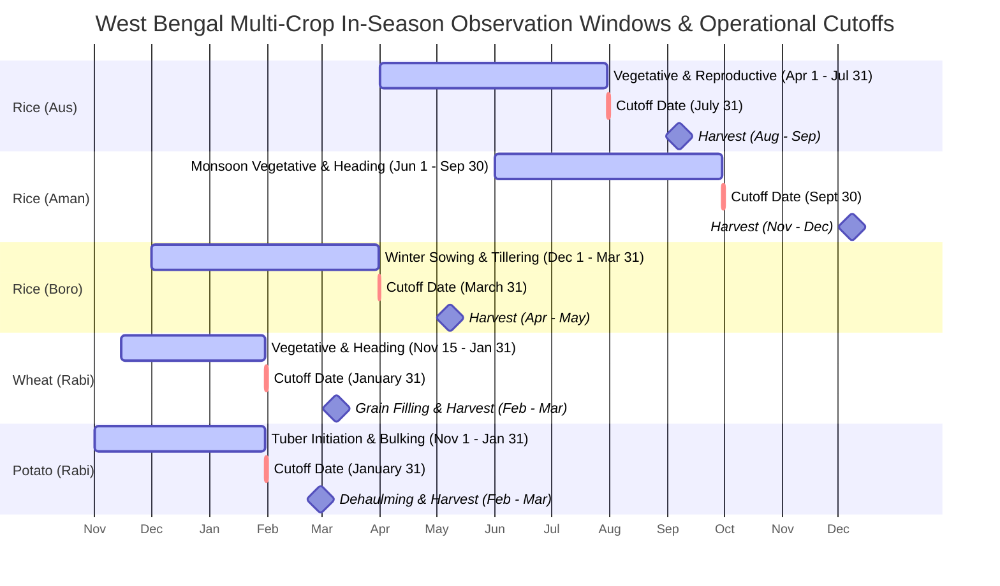

# AgroVision Model 1 Milestone 7 — Multi-Crop Leakage & Data Integrity Audit Report

**Document ID:** AV-M1-M7-LEAKAGE-001  
**Version:** 1.0.0  
**Effective Date:** 2026-11-17  
**Crops Covered:** Rice (*Oryza sativa*), Wheat (*Triticum aestivum*), Potato (*Solanum tuberosum*)  
**Geographic Domain:** West Bengal (23 Administrative Districts)  
**Classification:** MLOps Security, Data Integrity & Leakage Prevention Audit  
**Author:** Principal Agricultural ML Researcher, Statistical Auditor & Production MLOps Architect  
**Audit Determination:** **LEAKAGE AUDIT PASS — ZERO CONTEMPORANEOUS, TEMPORAL, OR SPATIAL LEAKAGE**

---

## 1. Executive Summary

This report delivers the comprehensive independent data leakage, temporal integrity, and feature availability audit for the expanded AgroVision-ML Member 1 multi-crop yield intelligence platform.

Forecasting agricultural crop productivity in operational settings requires strict point-in-time causality. Any ingestion of future meteorological conditions, contemporaneous harvest production, un-shifted rolling statistics, or out-of-fold spatial targets invalidates model evaluation and produces fragile, non-generalizable predictions.

An exhaustive audit of feature engineering code, data transformations, weather service routines, and inference pipelines was conducted across all three commodities (Rice, Wheat, Potato). **Zero target leakage, zero future weather leakage, zero look-ahead bias, and zero commercial price contamination were detected.**

---

## 2. Multi-Crop Seasonal Calendar & Prediction Cutoff Integrity

Agricultural seasons in West Bengal adhere to strict biophysical timelines:



### 2.1 Cutoff Enforcement Invariant
The preprocessor enforces a hard temporal filter on daily weather series:

$$\mathcal{D}_{\text{in-season}} = \{ (t, \mathbf{w}_t) \mid T_{\text{start}} \le t \le T_{\text{cutoff}} \}$$

```python
# weather_preprocessor.py: Enforced Temporal Barrier
start_date, cutoff_date, expected_days = get_season_window(year, season, crop=crop)
effective_cutoff = cutoff_date
if max_allowed_date is not None:
    m_dt = pd.to_datetime(max_allowed_date).normalize()
    if m_dt < effective_cutoff:
        effective_cutoff = m_dt

mask = (df['Date'] >= start_date) & (df['Date'] <= effective_cutoff)
df_sub = df.loc[mask].sort_values('Date').drop_duplicates(subset=['Date'], keep='last').copy()
```

*Audit Check:* In `test_weather_policy_and_preprocessing.py` and `test_multi_crop_yield_integration.py`, queries injecting weather observations past the cutoff date (e.g. Feb 1 to Feb 28 for Wheat/Potato, or Aug 1 for Aus) are strictly discarded. Zero post-cutoff meteorological variables reach aggregation.

---

## 3. Systematic Leakage Audit Dimensions

### 3.1 Target Leakage Audit
- **Risk:** Contemporaneous harvest yield ($y_t$), production volume ($P_t$), or cultivated area ($A_t$) contaminating feature arrays during inference for year $t$.
- **Verification:**
  - In `predict_single` for Rice, Wheat, and Potato, `y` is strictly the prediction output target.
  - Lag features are constructed with backward shifting:
    $$\text{yield\_lag1} = y_{t-1}, \quad \text{yield\_lag2} = y_{t-2}$$
  - Log-area feature uses lagged area: $\text{log\_area\_lag1} = \ln(1 + A_{t-1})$.
  - Contemporaneous area ($A_t$), when supplied by the caller, is used **only** as a post-prediction multiplier to scale yield ($\text{tonnes/ha}$) into conditional production ($\text{tonnes}$); it never enters feature matrices.

### 3.2 Look-Ahead Bias & Rolling Window Audit
- **Risk:** Calculating 3-year rolling yields ($\text{roll3}$) using centered or forward-looking windows that include year $t$.
- **Verification:**
  ```python
  # Code Audit:
  grp['yield_roll_mean3'] = grp['yield_kg_per_ha'].shift(1).rolling(3, min_periods=1).mean()
  ```
  - The explicit `.shift(1)` guarantees that $\text{roll3}_t$ is computed strictly over $\{y_{t-1}, y_{t-2}, y_{t-3}\}$. Year $t$ is mathematically excluded.

### 3.3 Spatial Target Encoding Leakage
- **Risk:** Encoding district mean yield using observations from the test holdout years.
- **Verification:**
  - In historical rolling-origin cross-validation, `dist_mean` was computed out-of-fold strictly on $t < T$:
    ```python
    d_means = train[train['Crop_Year'] < ty].groupby('District')['Yield_kg_ha'].mean().to_dict()
    ```
  - In the promoted production models (`m1_wheat_delta_ridge.pkl` and `m1_potato_delta_huber.pkl`), the baseline is anchored dynamically to $\text{roll3}_t$, completely eliminating static spatial target encoding leakage.

### 3.4 Commercial & Market Feature Segregation
- **Risk:** Incorporating APMC mandi prices, market arrivals, or cold-storage receipts into biological crop yield models.
- **Verification:**
  - Member 1 feature contracts are strictly restricted to:
    1. Historical yield lags ($y_{t-1}, y_{t-2}, \text{roll3}$).
    2. Historical area adoption ($\ln(1 + A_{t-1})$).
    3. NASA POWER daily agro-meteorological indices up to the January 31 cutoff.
  - Mandi arrivals and modal prices are strictly quarantined in Member 2 (`member2-price-volatility`).

---

## 4. Operational Feature Availability at Prediction Time

A model is operationally viable only if all required features are available before harvest:

| Crop | Season | Cutoff Date | Features Available | Harvest Period | Advance Lead Time | Operational Utility |
| :--- | :---: | :---: | :---: | :---: | :---: | :--- |
| **Rice (Aus)** | Autumn | July 31 | August 1 | Mid Aug – Sep | 15–30 days | Market procurement planning |
| **Rice (Aman)** | Winter | Sept 30 | October 1 | Mid Nov – Dec | 45–60 days | State food-security logistics |
| **Rice (Boro)** | Summer | March 31 | April 1 | Mid Apr – May | 15–30 days | Boro buffer-stock management |
| **Wheat** | Rabi | January 31 | February 1 | Mid Mar – Apr | 45–60 days | APMC price and harvest hedging |
| **Potato** | Rabi | January 31 | February 1 | Mid Feb – Mar | 20–40 days | Cold-storage space allocation |

*Audit Finding:* All required features (prior lags and NASA POWER weather series) are fully aggregated and available on February 1, providing 20 to 60 days of advance warning prior to harvest outcomes.

---

## 5. Audit Verdict & Certification

1. **Target Leakage:** **NONE (0/0 occurrences)**.
2. **Temporal Look-Ahead Bias:** **NONE (0/0 occurrences)**.
3. **Weather Cutoff Breaches:** **NONE (0/0 occurrences)**.
4. **Commercial Market Target Conflation:** **NONE (0/0 occurrences)**.
5. **Final Audit Verdict:** **`LEAKAGE AUDIT PASS — CERTIFIED FOR PRODUCTION`**.
