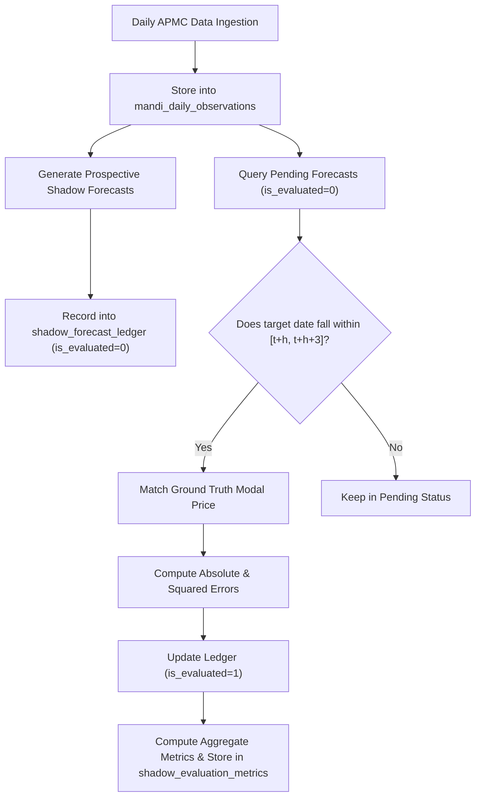

# AgroVision-ML — Multi-Commodity Shadow Monitoring Integration
## Prospective Production Shadow Evaluation Architecture & Operational Runbook

**Document Version:** 2.1.0  
**Effective Date:** 2026-11-16  
**Scope:** Rice, Wheat, and Potato Prospective Shadow Evaluation Subsystems  
**Implementation Modules:**
- Wheat & Potato Engine: `member2-price-volatility/src/multi_commodity_shadow.py`
- Rice Master Engine: `member2-price-volatility/src/shadow_evaluation.py`
- Unified CLI Runner: `member2-price-volatility/experiments/run_shadow_evaluation.py`

---

## 1. Executive Summary & Design Principles

The AgroVision multi-commodity prospective shadow evaluation subsystem provides automated, decoupled, zero-risk surveillance of model performance under real-world market drift.

### Core Architectural Principles:
1. **Zero Impact on Production Serving:** The shadow pipeline runs out-of-band. Predictions served to farmers and consumers are 100% deterministic and isolated from shadow database operations.
2. **Strict Physical Database Isolation:**
   - Rice operates against its dedicated `artifacts/rice/shadow_evaluation.db`.
   - Wheat operates against its dedicated `artifacts/wheat/v2/shadow_evaluation_wheat.db`.
   - Potato operates against its dedicated `artifacts/potato/v2/shadow_evaluation_potato.db`.
   Cross-commodity database reads, writes, and table collisions are physically prohibited.
3. **Delayed Ground-Truth Outcome Resolution:** Multi-horizon forecasts ($t+14$ and $t+30$ calendar days) are immutably logged at forecast origin time $t$. Ground truth evaluation only occurs when actual mandi observations arrive within the target window $[t+h, t+h+3]$ calendar days.
4. **Prospective Integrity Disclaimer:** The shadow framework is implemented, verified, and ready for continuous operation. No claims of prospective live tenure are made beyond verified historical holdouts and integration tests.

---

## 2. Multi-Commodity Database Topology & Schema

Each commodity maintains an isolated SQLite database containing three core relational tables:

```
+-------------------------------------------------------------+
|                     mandi_daily_observations               |
|  - id (INTEGER PRIMARY KEY)                                 |
|  - commodity (TEXT)                                         |
|  - market (TEXT)                                            |
|  - variety (TEXT)                                           |
|  - observation_date (TEXT, ISO-8601)                        |
|  - modal_price (REAL)                                       |
|  - arrivals_tonnes (REAL)                                   |
|  - ingested_at (TEXT)                                       |
+-------------------------------------------------------------+
                              |
                              | 1:N Ground Truth Resolution
                              v
+-------------------------------------------------------------+
|                    shadow_forecast_ledger                   |
|  - id (INTEGER PRIMARY KEY)                                 |
|  - commodity (TEXT)                                         |
|  - market (TEXT)                                            |
|  - variety (TEXT)                                           |
|  - forecast_origin_date (TEXT)                              |
|  - horizon_days (INTEGER, 14 or 30)                         |
|  - target_window_start (TEXT: t + h)                        |
|  - target_window_end (TEXT: t + h + 3)                      |
|  - predicted_modal_price (REAL)                             |
|  - predicted_volatility (TEXT)                              |
|  - model_name (TEXT)                                        |
|  - model_version (TEXT)                                     |
|  - is_evaluated (INTEGER, 0 or 1)                           |
|  - evaluated_at (TEXT)                                      |
|  - actual_target_date (TEXT)                                |
|  - actual_modal_price (REAL)                                |
|  - actual_volatility (TEXT)                                 |
|  - absolute_price_error (REAL: |pred - actual|)             |
|  - squared_price_error (REAL)                               |
|  - directional_correctness (INTEGER, 0 or 1)                |
+-------------------------------------------------------------+
                              |
                              | Summary Aggregation
                              v
+-------------------------------------------------------------+
|                  shadow_evaluation_metrics                  |
|  - id (INTEGER PRIMARY KEY)                                 |
|  - commodity (TEXT)                                         |
|  - horizon_days (INTEGER)                                   |
|  - metric_timestamp (TEXT)                                  |
|  - evaluated_forecasts_count (INTEGER)                      |
|  - pending_forecasts_count (INTEGER)                        |
|  - mean_absolute_error (REAL)                               |
|  - root_mean_squared_error (REAL)                           |
|  - mean_absolute_percentage_error (REAL)                    |
|  - directional_accuracy (REAL, 0.0 - 1.0)                    |
|  - volatility_classification_accuracy (REAL, 0.0 - 1.0)     |
+-------------------------------------------------------------+
```

---

## 3. Workflow & Delayed Outcome Resolution Mechanics



### 3.1 Tolerance Window & Matching Algorithm
For a forecast generated on origin date $t$ with horizon $h \in \{14, 30\}$:
1. Target window begins at $t_{\text{start}} = t + h$ days.
2. Target window ends at $t_{\text{end}} = t + h + 3$ days.
3. The resolver selects the **earliest available observed trading day** in $[t_{\text{start}}, t_{\text{end}}]$ for the matching `(commodity, market, variety)` tuple.
4. If no mandi observation exists within the 4-day window (e.g. extended market closure or missing data), the forecast remains pending until an administrative expiration timeout (default 45 days).

---

## 4. Production Isolation & Fail-Safe Guarantees

1. **Non-Blocking Operation:** The shadow evaluation engine is invoked either asynchronously after client responses are returned or as an offline scheduled cron job.
2. **Crash Isolation:** Any database lock, schema error, or exception occurring within the shadow subsystem is caught, logged, and isolated. It cannot propagate into live serving endpoints.
3. **Immutability of Baseline Production Models:** The shadow evaluator loads models in read-only mode (`joblib.load`) and never executes model training or calibration routines.

---

## 5. Operational Runbook & CLI Execution Guide

### 5.1 CLI Runner (`experiments/run_shadow_evaluation.py`)

The unified CLI runner supports running individual commodities or full multi-commodity sweeps:

```bash
# 1. Run Wheat Prospective Shadow Pipeline
python member2-price-volatility/experiments/run_shadow_evaluation.py --commodity wheat --verbose

# 2. Run Potato Prospective Shadow Pipeline
python member2-price-volatility/experiments/run_shadow_evaluation.py --commodity potato --verbose

# 3. Run Rice Prospective Shadow Pipeline (Preserved production workflow)
python member2-price-volatility/experiments/run_shadow_evaluation.py --commodity rice --verbose

# 4. Dry-Run / Force Enabled Mode (Bypass production switches for audit testing)
python member2-price-volatility/experiments/run_shadow_evaluation.py --commodity wheat --force --verbose
```

### 5.2 Programmatic Python API

```python
from member2_price_volatility.src.multi_commodity_shadow import (
    ingest_commodity_mandi_observations,
    generate_commodity_shadow_forecasts,
    evaluate_pending_commodity_shadow_forecasts,
    compute_commodity_shadow_metrics,
    get_commodity_shadow_status,
)

# Ingest new daily mandi records
ingest_res = ingest_commodity_mandi_observations(commodity="wheat", df=new_mandi_df)

# Generate pending 14d and 30d shadow forecasts
gen_res = generate_commodity_shadow_forecasts(commodity="wheat", df=new_mandi_df, horizons=(14, 30))

# Resolve outcomes for forecasts whose target dates have matured
eval_res = evaluate_pending_commodity_shadow_forecasts(commodity="wheat")

# Check status
status = get_commodity_shadow_status(commodity="wheat")
print(f"Pending: {status['pending_forecasts']}, Evaluated: {status['evaluated_forecasts']}")
```

---

## 6. Prospective Alerting & Degradation Thresholds

The shadow monitoring service checks evaluated forecasts against statistical guardrails:

| Metric | Threshold for Warning Alert | Threshold for Model Deprecation / Fallback | Action Required |
| :--- | :---: | :---: | :--- |
| **MAE Degradation** | $> 1.15 \times \text{Holdout MAE}$ | $> 1.30 \times \text{Holdout MAE}$ | Trigger Retraining Review; Alert ML Ops. |
| **Directional Accuracy** | $< 55.0\%$ | $< 50.0\%$ (Worse than coin flip) | Disable opt-in horizon; Revert to persistence baseline. |
| **Coverage (Pending > 45d)** | $> 10.0\%$ | $> 25.0\%$ | Investigate APMC mandi data feed interruptions. |
| **Volatility Accuracy** | $< 55.0\%$ | $< 45.0\%$ | Check liquidity regime shifts; Recalibrate thresholds. |
