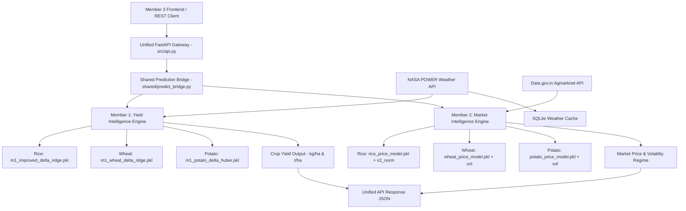

# AgroVision-ML — Member 3: Application & Systems Integration Guide (`staging/`)

> **Engineering guide for the unified AgroVision-ML application, FastAPI REST services, staging orchestration, and shared prediction bridge integration.**

---

## Table of Contents
- [1. Executive Overview](#1-executive-overview)
- [2. Unified Architecture & Data Flow](#2-unified-architecture--data-flow)
- [3. Supported Crops & Prediction Scope](#3-supported-crops--prediction-scope)
- [4. Shared Prediction Bridge (`shared/predict_bridge.py`)](#4-shared-prediction-bridge-sharedpredict_bridgepy)
- [5. FastAPI Service Specifications](#5-fastapi-service-specifications)
  - [5.1 Health Check (`GET /health`)](#51-health-check-get-health)
  - [5.2 Mandi Price Prediction (`POST /predict`)](#52-mandi-price-prediction-post-predict)
  - [5.3 Direct Calendar Horizon (`POST /predict-horizon`)](#53-direct-calendar-horizon-post-predict-horizon)
- [6. Request & Response Formats](#6-request--response-formats)
- [7. Error Handling & Guardrails](#7-error-handling--guardrails)
- [8. Staging Environment Configuration (`.env.staging`)](#8-staging-environment-configuration-envstaging)
- [9. Local Execution & Startup Scripts](#9-local-execution--startup-scripts)
- [10. Troubleshooting & Operational Runbook](#10-troubleshooting--operational-runbook)

---

## 1. Executive Overview

Member 3 delivers the application and integration layer bridging the machine learning models of Member 1 (biological crop yield forecasting) and Member 2 (wholesale mandi market intelligence) into a cohesive RESTful API and production staging environment.

### Core Objectives
1. **Single Access Interface:** Expose unified prediction endpoints through the `AgroVisionPredictor` shared bridge (`shared/predict_bridge.py`).
2. **Strict Semantic Enforcement:** Prevent domain confusion by isolating biological crop yield (kg/ha, t/ha) from trading arrivals (tonnes) and regional harvest production (tonnes).
3. **Operational Governance:** Gate experimental forecasting horizons behind runtime configuration flags.
4. **Staging Automation:** Provide cross-platform startup automation (`start_staging.sh`, `start_staging.ps1`) with live Agmarknet API ingestion and persistent SQLite shadow monitoring.

---

## 2. Unified Architecture & Data Flow



---

## 3. Supported Crops & Prediction Scope

AgroVision-ML supports **exactly three crops**:
1. **Rice (*Oryza sativa*):** Autumn (Aus), Winter (Aman), and Summer (Boro) biological yield; 87-mandi short-term price and direct 14D/30D horizons; normalized volatility.
2. **Wheat (*Triticum aestivum*):** Rabi biological yield; 38-mandi short-term price; 19-feature class-balanced volatility.
3. **Potato (*Solanum tuberosum*):** Rabi biological yield; 88-mandi short-term price; 19-feature class-balanced volatility.

---

## 4. Shared Prediction Bridge (`shared/predict_bridge.py`)

The `AgroVisionPredictor` class serves as the single programmatic import point for backend integration.

### Initialization & Configuration
```python
from shared.predict_bridge import AgroVisionPredictor

# Initialize bridge with production governance
predictor = AgroVisionPredictor(
    enable_seasonal_routing=True,     # Routes Boro rice to persistence baseline
    weather_missing_policy="persistence" # Fallback when in-season weather is absent
)
```

### Methods
- **`predict_yield(dict) -> YieldPredictionResult`:** Forecasts Rice yield across Aus, Aman, or Boro.
- **`predict_wheat_yield(dict) -> dict`:** Forecasts Rabi Wheat yield using `m1_wheat_delta_ridge.pkl`.
- **`predict_potato_yield(dict) -> dict`:** Forecasts Rabi Potato yield using `m1_potato_delta_huber.pkl`.
- **`predict_price(df, commodity="rice") -> dict`:** Forecasts next-observation modal price and volatility regime for `"rice"`, `"wheat"`, or `"potato"`.
- **`predict_price_horizon(df, horizon_days=14) -> dict`:** Evaluates fixed direct calendar horizon price.
- **`predict_all(df, commodity, yield_input) -> dict`:** Concurrently generates both biological yield and wholesale mandi market predictions in a single unified schema.

---

## 5. FastAPI Service Specifications

The FastAPI service is implemented in `member2-price-volatility/src/api.py`.

### 5.1 Health Check (`GET /health`)
Verifies service availability, loaded pipeline status, and shadow database connectivity.
- **Endpoint:** `GET /health`
- **Response:**
```json
{
  "status": "ok",
  "model": "rice-price-xgb",
  "volatility": "persistence",
  "supported_commodities": ["rice", "wheat", "potato"],
  "environment": "staging"
}
```

### 5.2 Mandi Price Prediction (`POST /predict`)
Generates point-in-time modal price forecast and market volatility classification.
- **Endpoint:** `POST /predict`
- **Query Parameters:** `volatility_version` (`v1` default, `v2_normalized` opt-in)
- **Headers:** `Content-Type: application/json`

### 5.3 Direct Calendar Horizon (`POST /predict-horizon`)
Evaluates 14-day or 30-day fixed calendar price forecasts under feature-flag control.
- **Endpoint:** `POST /predict-horizon`
- **Release Gating:** If `AGROVISION_ENABLE_HORIZONS` or the specific horizon flag is `false`, the endpoint immediately returns `403 Forbidden`.

---

## 6. Request & Response Formats

### Request Schema (`POST /predict`)
```json
{
  "market": "Burdwan",
  "variety": "Common",
  "prediction_date": "2024-01-15",
  "volatility_version": "v2_normalized",
  "history": [
    {
      "Reported Date": "2024-01-14",
      "Modal Price (Rs./Quintal)": 2450.0,
      "Arrivals (Tonnes)": 45.0,
      "Min Price (Rs./Quintal)": 2400.0,
      "Max Price (Rs./Quintal)": 2500.0
    }
  ]
}
```
*Requirement:* The `history` array must supply at least 30 consecutive chronological observations for feature engineering.

### Response Schema (`POST /predict`)
```json
{
  "market": "Burdwan",
  "variety": "Common",
  "prediction_date": "2024-01-15",
  "predicted_modal_price": 2485.50,
  "predicted_volatility_range": 35.0,
  "predicted_volatility_class": "MEDIUM",
  "volatility_version": "v2_normalized",
  "normalized_volatility_class": "MEDIUM",
  "normalized_volatility_probabilities": {
    "LOW": 0.1520,
    "MEDIUM": 0.6410,
    "HIGH": 0.2070
  },
  "warnings": []
}
```

---

## 7. Error Handling & Guardrails

| Status Code | Exception | Description | Recommended Remediation |
|:---:|:---|:---|:---|
| **400** | `InsufficientHistoryError` | Caller supplied fewer than 30 daily observations in `history`. | Ensure at least 30 continuous market days are passed. |
| **403** | `HTTPException(403)` | Attempted to invoke disabled horizon endpoint (e.g., 30D). | Check staging environment flags in `.env.staging`. |
| **422** | `RequestValidationError` | Pydantic payload validation failure (missing date, negative price). | Verify request against JSON schema. |
| **503** | `HTTPException(503)` | Model artifact missing or corrupted on disk. | Verify file integrity and SHA-256 digests in `models/`. |

---

## 8. Staging Environment Configuration (`.env.staging`)

Located at `staging/.env.staging`:

```bash
# Environment Identification
ENVIRONMENT=staging
AGROVISION_ENV=staging
AGROVISION_LOG_LEVEL=INFO

# Server Configuration
HOST=0.0.0.0
PORT=8000
WORKERS=2

# Open Government Data (data.gov.in) Mandi Ingestion
DATA_GOV_IN_API_BASE=https://api.data.gov.in/resource/9ef84268-d588-465a-a308-a864a43d0070
DATA_GOV_IN_RATE_LIMIT_RPS=2.0
DATA_GOV_IN_TIMEOUT_SECONDS=15.0

# Shadow Monitoring Switches
AGROVISION_ENABLE_SHADOW_EVALUATION=true
AGROVISION_ENABLE_RICE_SHADOW=true
AGROVISION_ENABLE_WHEAT_SHADOW=true
AGROVISION_ENABLE_POTATO_SHADOW=true
AGROVISION_ENABLE_VOLATILITY_SHADOW=true

# Horizon Release Governance
AGROVISION_ENABLE_HORIZONS=true
AGROVISION_ENABLE_HORIZON_14D=true
AGROVISION_ENABLE_HORIZON_30D=false

# Storage & Database Locations
AGROVISION_STORAGE_ROOT=./member2-price-volatility/data/processed
AGROVISION_RICE_SHADOW_DB_PATH=./member2-price-volatility/data/processed/shadow_evaluation_rice.db
AGROVISION_WHEAT_SHADOW_DB_PATH=./member2-price-volatility/data/processed/shadow_evaluation_wheat.db
AGROVISION_POTATO_SHADOW_DB_PATH=./member2-price-volatility/data/processed/shadow_evaluation_potato.db
```

---

## 9. Local Execution & Startup Scripts

### Linux / macOS (Bash)
```bash
chmod +x staging/start_staging.sh
./staging/start_staging.sh
```

### Windows (PowerShell)
```powershell
Set-ExecutionPolicy -Scope Process -ExecutionPolicy Bypass
.\staging\start_staging.ps1
```

### Direct Uvicorn Launch
```bash
python -m uvicorn api:app \
  --app-dir member2-price-volatility/src \
  --host 0.0.0.0 \
  --port 8000 \
  --reload
```

---

## 10. Troubleshooting & Operational Runbook

### Issue 1: `InsufficientHistoryError: History length (22) < minimum required (30)`
- **Cause:** Calling price prediction with fewer than 30 historical records prevents calculating 30-day moving averages and rolling standard deviations.
- **Fix:** Pad input with additional prior chronological observations for that market and variety.

### Issue 2: `403 Forbidden: 30-day horizon forecasting is currently disabled`
- **Cause:** Strict release governance prevents unvalidated horizon exposure.
- **Fix:** Enable flag in environment: `export AGROVISION_ENABLE_HORIZON_30D=true` (staging only).

### Issue 3: In-Season Weather Cache Misses
- **Cause:** Network firewall or rate-limiting against NASA POWER API.
- **Fix:** Ensure `member1-yield-model/data/cache/weather_cache.db` exists. The system automatically falls back to offline archives (`data/raw/weather/`) and persistence yield mode without crashing.
